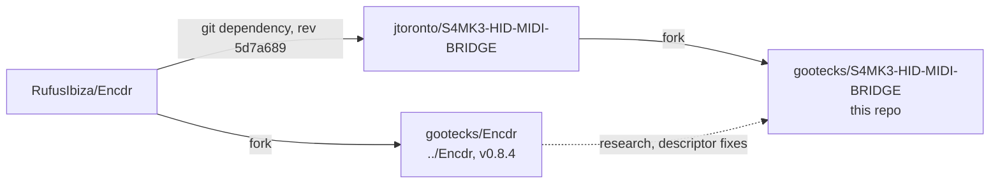

# Kontrol S8 support (gootecks fork)

This fork extends the S4 MK3 bridge to the Native Instruments Traktor Kontrol
S8. These notes are fork-only: they track the S8 work and are not part of any
upstream pull request.

## Status

| Area                | State                                                                 |
| ------------------- | --------------------------------------------------------------------- |
| S4 MK3              | Behaviour unchanged from upstream `v0.2.1-beta.1`; device-profile seam added (#5). |
| S8 detection        | Listed and identified by the bridge (`--device s8`); never opened.    |
| S8 input            | Read alongside MIDI mode on macOS; CUE and display buttons send HID but no MIDI ([input-capture.md](input-capture.md), #10). |
| S8 Djay mapping     | Bridge catalog not started (#13, #14). A working Controller Editor setup exists (below). |
| S8 LEDs             | Partial evidence in Encdr; output framing unresolved (#21).           |
| S8 screens          | Frame format known from Windows evidence. S8 MIDI needs NIHardwareAgent, so direct screens mean full bridge control (#26, [agent-stop-validation.md](agent-stop-validation.md)). Phase 1: interface 6 claims cleanly with the agent stopped ([screen-claim-validation.md](screen-claim-validation.md)). Frame phases await approval ([screens.md](screens.md)). |
| Motor, jog tension  | Not applicable: the S8 has touchstrips, not platters.                 |
| Clippy gate         | Upstream `main` fails `-D warnings` on Rust 1.99.1 (pinned); tests pass (#28). |

Issue map: epics and milestones on the
[Kontrol S8 Bridge](https://github.com/users/gootecks/projects/4) board.

## Existing S8 setup with Djay

The S8 already works in Djay without the bridge: NIHardwareAgent runs a
Controller Editor MIDI template (based on Evan's Traktor Kontrol S8 layout)
and publishes the control MIDI on its virtual `Traktor Kontrol S8 Input` port;
a hand-tuned Djay mapping (`Evan's Traktor Kontrol S8 1.1`, endpoint name
`Traktor Kontrol S8`) receives it. Both live in a separate, private settings
repository and are in regular use for sets.

- The bridge must not disturb that setup. Its S8 endpoint
  (`Kontrol S8 MIDI Full`) and mapping file name
  (`Kontrol S8 Bridge.djayMidiMapping`) differ from it; a unit test enforces
  this.
- That mapping is the reference for which controls and Djay actions the
  bridge's S8 catalog should cover (#13, #14).

## Upstream projects

- The bridge depends on upstream Encdr by git revision, not on the gootecks
  fork. Encdr changes needed for the S8 should become PRs to RufusIbiza/Encdr
  before the bridge pins them.
- `../Encdr` holds S8 research: `encdr/descriptors/ni_kontrol_s8.json`,
  `docs/hardware/ni_kontrol_s8.md`, `docs/hardware/attempts/`,
  `s8_discovery/`, and the `examples/kontrol_s8/` probes.

How to keep contributions acceptable upstream: [upstream-workflow.md](upstream-workflow.md).

## Hardware boundaries

- Reading HID input in shared mode is passive. Everything else is output:
  LED/interrupt-OUT reports, feature reports, EP0 control transfers, bulk
  screen traffic and motor commands.
- No S8 output without a written, bounded test plan and explicit approval.
  Issues that need output carry the `hardware-write` label.
- Never touch interface 4 (DFU), firmware updaters, or USB/MIDI mode switches.
- Do not stop or replace NIHardwareAgent, Controller Editor templates or Djay
  mappings without explicit scope. Preserve user-edited mappings.
- Unit tests, generated mappings and successful HID writes do not prove
  physical behaviour; label untested behaviour plainly (see `AGENTS.md`).

## Documents

- [hardware-notes.md](hardware-notes.md) — S8 USB identity, interfaces, input
  and output evidence, open questions.
- [s4-coupling-audit.md](s4-coupling-audit.md) — S4 MK3 assumptions in the
  bridge with file anchors, and the proposed device-profile seam.
- [upstream-workflow.md](upstream-workflow.md) — remotes, branches, commit
  separation, upstream PR procedure.
- [input-capture.md](input-capture.md) — passive HID and MIDI capture in
  Controller Editor MIDI mode: which controls lack MIDI, undocumented bytes.
- [screens.md](screens.md) — display protocol summary, source conflicts,
  macOS ownership, and the phased first-frame test plan.
- [agent-stop-validation.md](agent-stop-validation.md) — phase 0: what
  changes when NIHardwareAgent stops, and the attended check
  (`agent-stop-check.sh`).
- [screen-claim-validation.md](screen-claim-validation.md) — phase 1:
  claiming interface 6 without transfers (`screen-claim-check.sh`).
- [research-sources.md](research-sources.md) — kontrol-s8-protocol, Encdr
  and Mixxx survey, with licensing notes.

Future notes (created by their issues): `mapping.md` (#13, #14),
`led-output.md` (#21, #24).

## Prior research outside this repo

An earlier passive-capture investigation of S8 screens with Djay lives in a
separate local research workspace (`djay-pro`: S8 screen investigation, Djay
architecture, NI frame-format audit, protocol capture plan). Its G1–G10 write
gates and display envelope findings feed #26.
