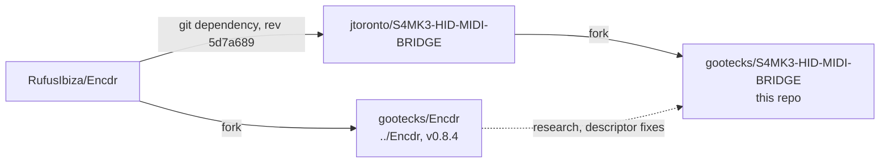

# Kontrol S8 support (gootecks fork)

This fork extends the S4 MK3 bridge to the Native Instruments Traktor Kontrol
S8. These notes are fork-only: they track the S8 work and are not part of any
upstream pull request.

## Status

| Area                | State                                                                 |
| ------------------- | --------------------------------------------------------------------- |
| S4 MK3              | Unchanged from upstream `v0.2.1-beta.1` (`ee12026`).                  |
| S8 detection        | Enumerated by macOS only; the bridge has no S8 profile yet.           |
| S8 input            | Encdr has a descriptor; not yet verified on this Mac (#10).           |
| S8 Djay mapping     | Not started (#13, #14).                                               |
| S8 LEDs             | Partial evidence in Encdr; output framing unresolved (#21).           |
| S8 screens          | Encdr v0.8.4 has an NI-service route; transport undecided (#26).      |
| Motor, jog tension  | Not applicable: the S8 has touchstrips, not platters.                 |
| Clippy gate         | Upstream `main` fails `-D warnings` on Rust 1.97; tests pass (#28).   |

Issue map: epics and milestones on the
[Kontrol S8 Bridge](https://github.com/users/gootecks/projects/4) board.

## Upstream projects

- The bridge depends on upstream Encdr by git revision, not on the gootecks
  fork. Encdr changes needed for the S8 should become PRs to RufusIbiza/Encdr
  before the bridge pins them.
- `../Encdr` holds S8 research: `encdr/descriptors/ni_kontrol_s8.json`,
  `docs/hardware/ni_kontrol_s8.md`, `docs/hardware/attempts/`,
  `s8_discovery/`, and the `examples/kontrol_s8/` probes.

How to keep contributions acceptable upstream: [upstream-workflow.md](upstream-workflow.md).

## Hardware boundaries

- Reading HID input in shared mode is passive. Everything else is output:
  LED/interrupt-OUT reports, feature reports, EP0 control transfers, bulk
  screen traffic and motor commands.
- No S8 output without a written, bounded test plan and explicit approval.
  Issues that need output carry the `hardware-write` label.
- Never touch interface 4 (DFU), firmware updaters, or USB/MIDI mode switches.
- Do not stop or replace NIHardwareAgent, Controller Editor templates or Djay
  mappings without explicit scope. Preserve user-edited mappings.
- Unit tests, generated mappings and successful HID writes do not prove
  physical behaviour; label untested behaviour plainly (see `AGENTS.md`).

## Documents

- [hardware-notes.md](hardware-notes.md) — S8 USB identity, interfaces, input
  and output evidence, open questions.
- [s4-coupling-audit.md](s4-coupling-audit.md) — S4 MK3 assumptions in the
  bridge with file anchors, and the proposed device-profile seam.
- [upstream-workflow.md](upstream-workflow.md) — remotes, branches, commit
  separation, upstream PR procedure.

Future notes (created by their issues): `input-capture.md` (#10),
`mapping.md` (#13, #14), `led-output.md` (#21, #24), `screens.md` (#26).

## Prior research outside this repo

An earlier passive-capture investigation of S8 screens with Djay lives in a
separate local research workspace (`djay-pro`: S8 screen investigation, Djay
architecture, NI frame-format audit, protocol capture plan). Its G1–G10 write
gates and display envelope findings feed #26.
