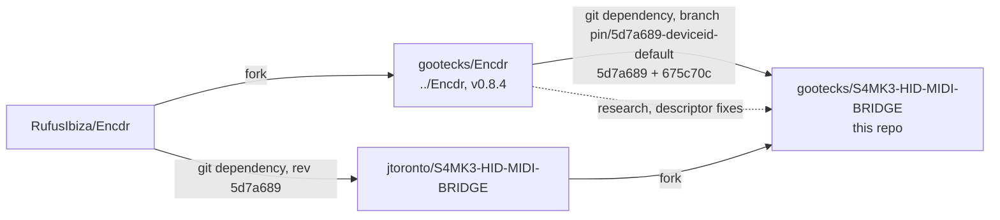

# Kontrol S8 support (gootecks fork)

This fork extends the S4 MK3 bridge to the Native Instruments Traktor Kontrol
S8. These notes are fork-only: they track the S8 work and are not part of any
upstream pull request.

<?toc
max-level: 2
?>

- [Status](#status)
- [Existing S8 setup with Djay](#existing-s8-setup-with-djay)
- [Upstream projects](#upstream-projects)
- [Hardware boundaries](#hardware-boundaries)
- [Documents](#documents)
- [Prior research outside this repo](#prior-research-outside-this-repo)

<?/toc?>

## Status

| Area               | State                                                                                                                                                                      | Details                                                               |
| ------------------ | -------------------------------------------------------------------------------------------------------------------------------------------------------------------------- | --------------------------------------------------------------------- |
| S4 MK3             | Unchanged from upstream `v0.2.1-beta.1`; device-profile seam added (#5).                                                                                                   | [s4-coupling-audit.md](s4-coupling-audit.md)                          |
| S8 detection       | `--device s8 --raw` reads interface 5 and never writes (#12).                                                                                                              | [hardware-notes.md](hardware-notes.md)                                |
| S8 input           | All 191 controls captured and decoded (#10, #12).                                                                                                                          | [S8 input](#s8-input)                                                 |
| S8 Djay mapping    | Generated, translated and checked in Djay (#14, #15).                                                                                                                      | [S8 Djay mapping](#s8-djay-mapping)                                   |
| S8 LEDs            | Deck LEDs from Djay with `--s8-leds` checked on the S8 on 2026-11-11 (#22, #23); open rows in #125. Framing and byte map checked (#21); VU, `0xF3` and `0xF4` open (#123). | [mapping.md](mapping.md#led-feedback), [led-output.md](led-output.md) |
| S8 screens         | Library views and deck pages checked on the S8; the rest is in #105.                                                                                                       | [S8 screens](#s8-screens)                                             |
| Motor, jog tension | Not applicable: the S8 has touchstrips, not platters.                                                                                                                      |                                                                       |
| Clippy gate        | Upstream `main` fails `-D warnings` on Rust 1.99.1 (pinned); tests pass (#28).                                                                                             |                                                                       |

### S8 input

On macOS the S8 sends HID input alongside MIDI mode. CUE and the display
buttons send HID but no MIDI. All 191 controls were captured with the agent
stopped, with corrections to both sources (#10,
[input-capture.md](input-capture.md)). The bridge applies those corrections
and decodes every verified control in `--raw`. A fixture test replays the
capture through the decoder (#12). `mise run s8:raw` runs the read-only log.

### S8 Djay mapping

The bridge holds a catalog and generates a default mapping from it
(`--generate-mapping <path> --device s8`, [mapping.md](mapping.md), #14).
`--device s8 --midi full` translates S8 input to that mapping's MIDI on
`Kontrol S8 MIDI Full` and writes nothing to the S8 unless `--s8-leds` is
given ([LED feedback](mapping.md#led-feedback), #15, #22). `mise run s8:midi`
runs it without that flag.

Five attended checks in Djay on 2026-11-10 covered the mapping
([translator-validation.md](translator-validation.md)). The touchstrip keeps
its absolute 7-bit encoding (#13). CAPTURE and the booth output are still open.
The checked mapping is kept in [mappings/](mappings/README.md).

Open Controller Editor before `mise run s8:midi`. Started without it, the S8
was once dark and unusable
([translator-validation.md](translator-validation.md#s8-dark-at-start)). The
S8 runs from a source build only: the menu-bar app does not run it. A working
Controller Editor setup exists ([below](#existing-s8-setup-with-djay)).

### S8 screens

The S8 MIDI needs NIHardwareAgent. So direct screens mean the bridge runs the
whole S8 (#26, [agent-stop-validation.md](agent-stop-validation.md)). With the
agent stopped, interface 6 claims cleanly
([screen-claim-validation.md](screen-claim-validation.md)). Both panels show
the frames our tools send: run-length frames and full frames of raw RGB565
([screen-frame-validation.md](screen-frame-validation.md)).

Repeated frames work with a held claim, and so do partial updates (#43,
[screen-stream-validation.md](screen-stream-validation.md)). The ceiling is
about 60 full frames per second in total, so 30 per panel with both in use.
The bridge shows frames from stdin on both panels and stops cleanly on Ctrl-C
(#44, [screen-transport-validation.md](screen-transport-validation.md)).

The app renders the library views from djay's sidebar (#48–#50). The display
buttons and screen encoders drive that sidebar on the S8 (#51,
[display-buttons-validation.md](display-buttons-validation.md)).
`S8Host --screens` draws the library views and one deck page from live djay
data and sends them to the bridge (#27, [panel-views.md](panel-views.md)).
One run on the S8 checked it
([panel-views-validation.md](panel-views-validation.md)). During a fast
encoder turn the panel jumps to the last row (#90).

Two runs on the S8 compared the deck pages with djay's deck data
([deck-data-validation.md](deck-data-validation.md)). What is left of the
screens is low priority and collected in #105. It includes a deck page that
did not return from One Deck view (#93) and a cue colour fix not yet seen on
the S8 (#101).

Issue map: epics and milestones on the
[Kontrol S8 Bridge](https://github.com/users/gootecks/projects/4) board.

## Existing S8 setup with Djay

The S8 already works in Djay without the bridge. NIHardwareAgent runs a
Controller Editor MIDI template, based on Evan's Traktor Kontrol S8 layout. It
publishes the control MIDI on its virtual `Traktor Kontrol S8 Input` port. A
hand-tuned Djay mapping receives it: `Evan's Traktor Kontrol S8 1.1`, with the
endpoint name `Traktor Kontrol S8`. Both live in a separate, private settings
repository and are in regular use for sets.

- The bridge must not disturb that setup. Its S8 endpoint
  (`Kontrol S8 MIDI Full`) and mapping file name
  (`Kontrol S8 Bridge.djayMidiMapping`) differ from it; a unit test enforces
  this.
- That mapping is the reference for a second S8 layout (#65); the generated
  default layout follows the stock S8 functions instead ([mapping.md](mapping.md)).

## Upstream projects

- Upstream's bridge depends on upstream Encdr by git revision. This fork
  pins a gootecks/Encdr branch that is `5d7a689` plus one upstream commit
  (`675c70c`, `Default` for `DeviceId`), needed by the S8 descriptor
  corrections (#12). Other Encdr changes needed for the S8 should become PRs
  to RufusIbiza/Encdr before the bridge pins them.
- `../Encdr` holds S8 research: `encdr/descriptors/ni_kontrol_s8.json`,
  `docs/hardware/ni_kontrol_s8.md`, `docs/hardware/attempts/`,
  `s8_discovery/`, and the `examples/kontrol_s8/` probes.

How to keep contributions acceptable upstream: [upstream-workflow.md](upstream-workflow.md).

## Hardware boundaries

- Reading HID input in shared mode is passive. Everything else is output:
  LED/interrupt-OUT reports, feature reports, EP0 control transfers, bulk
  screen traffic and motor commands.
- No S8 output without a written, bounded test plan and explicit approval.
  Issues that need output carry the `hardware-write` label.
- Never touch interface 4 (DFU), firmware updaters, or USB/MIDI mode switches.
- Do not stop or replace NIHardwareAgent, Controller Editor templates or Djay
  mappings without explicit scope. Preserve user-edited mappings.
- Unit tests, generated mappings and successful HID writes do not prove
  physical behaviour; label untested behaviour plainly (see `AGENTS.md`).

## Documents

The notes are listed in [`INDEX.md`](../../INDEX.md) at the root of the repository, by type,
with their summaries and issues. It also lists the READMEs next to the code and upstream's
documents.

## Prior research outside this repo

An earlier passive-capture investigation of S8 screens with Djay lives in a
separate local research workspace, `djay-pro`. It holds the S8 screen
investigation, notes on the Djay architecture, an NI frame-format audit and a
protocol capture plan. Its G1–G10 write gates and display envelope findings
fed #26. Its `djay-phrase-tool` prototype (Djay deck data and 480×272 page
layouts) is the starting point for #45.
