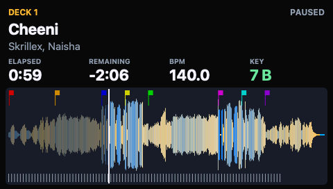
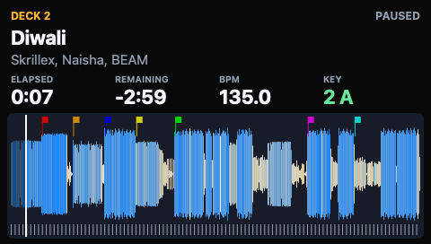
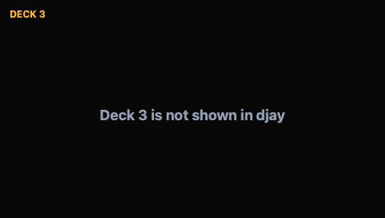
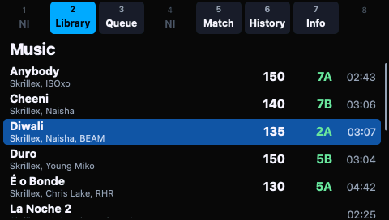
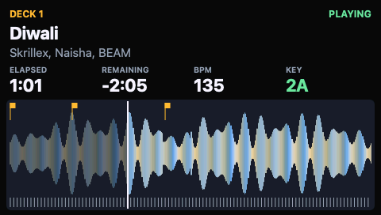
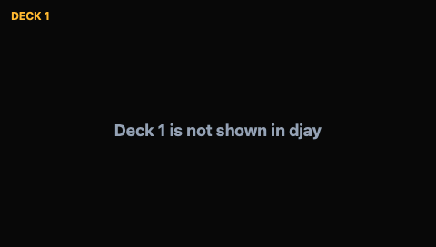
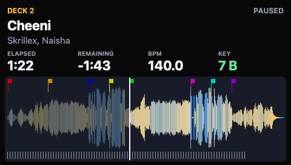
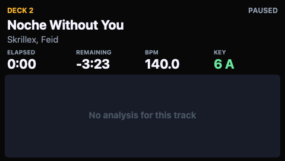
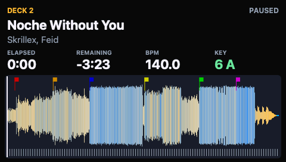

# Deck data on the S8 panels: validation (#45)

What the deck pages are built from, and their limits:
[deck-pages.md](deck-pages.md). This page holds the attended check of the
live djay deck data on the S8: the plan, the run of 2026-11-10 under
[Observed on the S8](#observed-on-the-s8-attended-run-2026-11-10) and the
run after the fixes for #92 to #95 under
[Observed on the S8, 2026-11-11](#observed-on-the-s8-attended-run-2026-11-11).

## State before this check

Issue #45 asks for a snapshot source that reads the decks from djay, with
two acceptance points. Both were met by PR #77: `swift test --package-path
macos` covers snapshot parsing, and the deck page renders from live djay
data in the preview window.

On the S8 so far ([deck-pages.md](deck-pages.md#deck-pages-on-the-s8-85),
[panel-views-validation.md](panel-views-validation.md)):

- Decks 1 and 2 paused, deck 1 played and paused, decks 3 and 4 in Four
  Decks played and paused: the page of the right deck, a time that moves
  only while the deck plays.
- `S8Host --screens --deck 1` with the library list on the other panel.

Not looked at on the S8 before, and the subject of this check: whether the
content matches djay (title, artist, BPM, key, remaining time, cue flags,
playhead), two decks playing at once, a jump inside a track, a tempo
change, a loop, a track change, a deck that is not in djay's layout, a
layout change while the stream runs, and `S8Host --deck 2`.

## Attended check

This section is the plan. Run once, on 2026-11-10, with the rows as they
stood then; rows 11 to 13, 16 and 19 have changed since (see *After the
run*). Every run needs explicit approval because it stops NIHardwareAgent
and sends screen frames to the S8.

`mise run s8:deck-data` (`deck-data-check.sh`), at the S8 with djay Pro and
Controller Editor open, djay in its Two Decks layout, a track with cue
points loaded and paused on decks 1 and 2, and the sidebar on Library.

What is sent: full-panel frames to interface 6, at most 30 per second per
panel, through the bridge's `--s8-screens-stdin` transport checked on the
S8 in #44 ([screen-transport-validation.md](screen-transport-validation.md)),
and the black exit frames. Nothing else is written: no LED reports, no
feature reports, no control transfers, nothing on interface 4. djay is only
read, through Accessibility and a copy of its library.

The runner reads djay once before it stops anything and refuses when that
fails. It then stops the agent with SIGKILL, runs three parts, asks one
question per row and relaunches the agent on every exit path. Unlike
`s8:deck-page` the stream is not timed: each part runs until its rows are
answered. Answering `stop` to any row goes straight to recovery. Stop on any
of these: a panel that stays frozen or garbled, an S8 that goes dark, a
status line `failed`.

| Part | Command | Panels |
| --- | --- | --- |
| A | `S8Preview --stream left=1,right=2` piped into `bridge --device s8 --midi full --s8-screens-stdin --until-stopped` | left deck 1, right deck 2 |
| B | the same with `left=3,right=4` | left deck 3, right deck 4 |
| C | `S8Host --screens --deck 2 --log-deck-polls` | left library list, right deck 2 |

Parts A and B end when the runner sends SIGTERM to S8Preview: the bridge's
stdin closes, it sends the black exit frames and exits. Part C ends when the
runner closes S8Host's stdin. Start, stop and load decks in djay's window.

### Expected pictures

Decoded from the records `S8Preview --stream … --seconds 2` wrote on
2026-11-10, read from djay as it was then, with nothing sent to the S8:
`s8-screen-png` reads the records with the bridge's stdin parser and decodes
the frame the bridge would transfer. The tracks in the run will differ, so
the pictures show the layout and the kind of content, not the text.

| State | Left panel | Right panel |
| --- | --- | --- |
| `01-decks-1-2`: part A at its start, both decks paused |  |  |
| `02-decks-3-4-two-deck-layout`: part B while djay shows Two Decks |  |  |
| `10-deck` of [panel-views.md](panel-views.md): part C, with deck 2 in place of deck 1 and a synthetic track |  |  |
| `03-deck-not-shown`: `S8Host --screens --deck 1` while djay's One Deck view shows deck 2 (#93) |  |  |

Picture `02` was made again the same way after #93 changed its text.
Picture `03` comes from `S8Host --replay` with the snapshot of `10-deck` and
a deck snapshot that holds only the notice, decoded by `s8-screen-png`; djay
was not in One Deck view for it.

### Rows

After each of rows 1 to 14 and 16 to 19 the runner notes how many records
S8Preview wrote for each panel since the previous row, with the deck, time,
play state and title of the last one.

| Row | Action | Expected |
| --- | --- | --- |
| 1 | Part A starts | Layout as `01-decks-1-2`; title, artist, BPM and key of each panel as djay shows them for that deck |
| 2 | Compare REMAINING with djay | The same on both decks |
| 3 | Compare the cue flags and the playhead with djay | Same number of flags, same colours and order as the deck's cue points; playhead at the same place as in djay's overview waveform |
| 4 | Play both decks about 15 s, pause both | Both panels say PLAYING, both times move with djay's, no panel stalls |
| 5 | Deck 1 paused: move to another position | Time and playhead on the left panel follow within about 1 s |
| 6 | Deck 1 playing: jump again, then pause | The left panel follows the jump and goes on with djay's time |
| 7 | Deck 2 tempo to about +8 % | BPM on the right panel changes to djay's BPM |
| 8 | Play deck 2 about 20 s at that tempo, pause, reset tempo | REMAINING stays the same as djay's |
| 9 | Deck 1: 4-beat loop for about 10 s while playing | Reported; looping is not modelled |
| 10 | Load another track on deck 1 | Left panel changes to its title, artist, BPM, key, waveform and cue flags, playhead at the start; delay reported |
| 11 | Optional: set a new cue point on deck 2, without reloading the track | A new flag on the right panel within about 10 s (#92) |
| 12 | Optional: load on deck 2 a track djay has not analysed | "No analysis for this track", then waveform, beat ticks and cue flags within about 10 s of djay ending its analysis (#95) |
| 13 | Optional: switch djay to One Deck view for about 10 s, and back | The panel of the deck djay does not show says "Deck N is not shown in djay", the other keeps its page; after the switch back both are as before (#93) |
| 14 | Part A as a whole | No flicker, tearing, wrong colours or frozen panel |
| 15 | Runner ends the stream | Both panels black, bridge exit status 0 |
| 16 | Part B starts, djay in Two Decks | "Deck 3 is not shown in djay" and "Deck 4 is not shown in djay", as `02-decks-3-4-two-deck-layout` |
| 17 | Switch djay to Four Decks, load decks 3 and 4 | The panels fill with decks 3 and 4, content as in djay; delay reported |
| 18 | Play decks 1 and 3 together about 10 s, pause both | Left panel moves with deck 3; right panel (deck 4) stands still |
| 19 | Switch djay back to Two Decks | Both panels return to "Deck N is not shown in djay" |
| 20 | Runner ends the stream | Both panels black, bridge exit status 0 |
| 21 | Part C starts | Right: deck 2 page, layout as `10-deck`; left: library list |
| 22 | Play deck 2; turn a left screen encoder through some rows; pause | PLAYING with moving time and playhead; the left panel follows while the deck page keeps moving |
| 23 | Runner closes S8Host's stdin | Both panels black, exit status 0 |
| 24 | Agent relaunched | Controller Editor labels on the panels |
| 25 | Left PLAY | djay reacts through the Controller Editor setup |
| 26 | Display button 1 or 4 | NI action works again |

Rows 9, 12 and 13 have no pass criterion: they record what the page does in
a case the code does not handle or was not tried with. Row 11 states what
the code does; a new flag would be a surprise, not a fault.

The record goes to `captures/deck-data-<UTC>/`: `notes.txt` with the answers
and the runner's notes, per part the stream log and the bridge output
(`decks-1-2.stream.log`, `decks-1-2.bridge.log`, the same for `decks-3-4`,
and `host-deck-2.log`) with a time stamp per line, gzipped before a commit,
`snapshots.txt` and `events.txt`.

## Observed on the S8: attended run, 2026-11-10

`mise run s8:deck-data` at commit `07efb78`, run by the user at the S8 with
djay Pro and Controller Editor open. The runner stopped NIHardwareAgent,
ran part A (23:19 to 23:28 UTC), part B (23:28 to 23:30) and part C (23:30
to 23:31), and relaunched the agent. S8Preview and the bridge were release
builds, S8Host the debug build.

Sent to the S8: full-panel screen frames and the black exit frames through
the bridge's `--s8-screens-stdin` transport. Nothing else.

Record:
[captures/deck-data-20261110T231900Z](captures/deck-data-20261110T231900Z/).

The "Reported" column is the user's answer, unchanged. Before the stop the
panels showed "Controller Editor labels".

| Row | Action | Expected | Reported |
| --- | --- | --- | --- |
| 1 | Part A starts: title, artist, BPM and key of each panel the same as djay shows for that deck? | yes, layout as `01-decks-1-2` | "y" |
| 2 | REMAINING on each panel the same as in djay? | yes | "y" |
| 3 | Cue flags: same number, colours and order as the deck's cue points in djay? Playhead at the same place as in djay's overview waveform? | yes | "y" |
| 4 | Play both decks about 15 s, pause both: both PLAYING, both times moving with djay's, no panel stalling? | yes | "y" |
| 5 | Deck 1 paused, moved to another position: do time and playhead follow within about 1 s? | yes | "y" |
| 6 | Deck 1 playing, jump again: does the left panel follow and go on with djay's time? | yes | "y" |
| 7 | Deck 2 tempo to about +8 %: does BPM change to djay's BPM? | yes | "y" |
| 8 | Deck 2 played about 20 s at that tempo: does REMAINING stay the same as djay's? | yes | "y" |
| 9 | Deck 1: 4-beat loop for about 10 s while playing. What did time and playhead do? | – | "looped as expected" |
| 10 | Another track loaded on deck 1: title, artist, BPM, key, waveform, cue flags, playhead at the start? How long did it take? | yes | "yes, instant" |
| 11 | New cue point set on deck 2: does a new flag appear? | no | "n" |
| 12 | A track djay has not analysed, or a title in a non-Latin script, on deck 2: what does the right panel show? | – | "shows track name and artist, but the waveform says no analysis for this track" |
| 13 | A djay view that hides the decks or their times, about 10 s, and back: what did the panels show? | – | "i switched to One Deck view and Deck 1 said no track on deck 1. then i loaded a track into deck 2 and it shows the track's info and waveform" |
| 14 | Any flicker, tearing, wrong colours or a frozen panel so far? | no | "no" |
| 15 | After the stream ended, agent still stopped: what do the panels show? | both black | "both black" |
| 16 | Part B starts, djay in Two Decks: "No track on deck 3" and "No track on deck 4"? | yes, as `02-decks-3-4-two-deck-layout` | "y" |
| 17 | Four Decks, decks 3 and 4 loaded: do the panels fill with title, artist, BPM, key and remaining time as in djay? How long after the switch? | yes | "yes. instant" |
| 18 | Decks 1 and 3 played together about 10 s: left panel moving with deck 3, right panel (deck 4) standing still? | yes | "y" |
| 19 | Back to Two Decks: "No track on deck 3" and "No track on deck 4" again? | yes | "y" |
| 20 | After the stream ended: what do the panels show? | both black | "both black" |
| 21 | Part C starts: deck 2 page on the right, library list on the left? | yes, layout as `10-deck` | "y" |
| 22 | Deck 2 played: PLAYING with moving time and playhead? Left screen encoder through some rows: does the left panel follow while the deck page keeps moving? | yes | "y" |
| 23 | After S8Host's stdin closed: what do the panels show? | both black | "both black" |
| 24 | After the agent was relaunched: what do the panels show? | Controller Editor labels | "Controller Editor labels" |
| 25 | Left PLAY: did djay react? | yes | "y" |
| 26 | Display button 1 or 4: does the NI action work again? | yes | "y" |

Noted by the runner:

- Parts A and B: bridge exit status 0, status lines `S8_SCREEN_STATUS
  pending`, `active`, `inactive`, no bridge process left. Part A wrote 500
  records (left 290, right 210), part B 82 (left 79, right 3).
- Part C: S8Host exit status 0, the same three status lines, no bridge
  process left.

The logs hold no warning or error line. The bridge log of part A holds one
press of the S8's left PLAY, 105 s into the part (8 input events, 8 MIDI
messages on `Kontrol S8 MIDI Full`); no row asked for it.

### From the stream logs

Each line of a stream log is one record S8Preview wrote, with the deck's
time, play state and title as the page showed them. They are what was
sent, not what djay showed.

| Row | In the log |
| --- | --- |
| 4 | Deck 1 playing from 112.4 s to 140.4 s of the stream, deck 2 from 117.4 s to 137.3 s; 89 and 80 records. |
| 5 | Two position changes on the paused deck 1: to 0.00, then to 137.41. One record each. |
| 6 | While playing, elapsed went from 140.30 to 82.51 between two records 0.45 s apart and counted on from there. |
| 7 | 56 records for the right panel with elapsed and remaining unchanged. The BPM is not in the stream log. |
| 8 | Deck 2 playing for 15.4 s of the stream while elapsed went from 28.82 to 45.48, 1.085 times as fast. Elapsed plus remaining stayed 186.70. |
| 9 | Deck 1 playing for 38 s, 125 records, while elapsed stayed between 27.48 and 29.09. It stepped back 22 times, about every 1.7 s. |
| 10 | The title changed from "Cheeni" to "Anybody" with elapsed 0.00 in one record. |
| 11 | Deck 2 moved to 168.20, 163.20 and 168.20; three records. |
| 12 | "Thistle", elapsed 0.00, remaining 235.08. |
| 13 | The left panel went to the empty page (no title, no time) 490 s into the stream. No record for it followed until the bridge stopped at 541 s. The right panel changed to "Scut 2", elapsed 0.00, at 498 s. |
| 17 | Both panels filled in the same pass, 19.1 s into the stream: deck 3 "É o Bonde" at 99.54 of 282.04 s, deck 4 "Scut 2" at 59.84 of 178.34 s. |
| 18 | Deck 3 playing from 58.1 s of the stream; 47 records for the left panel up to the answer, none for the right. |
| 19 | Deck 3 was still playing in the record before the empty page, 82.0 s into the stream. |

### Deck reads during part C

From the `deck poll` lines of `host-deck-2.log.gz`: 336 reads in 84 s, mean
gap 0.252 s. Three reads took longer than 0.45 s, and the next read started
that much later: 0.483 s (the first read), 0.634 s at 50 s and 0.775 s at
56 s into the run. No other read took longer than 0.273 s. The left screen
encoder was touched from 70 s to 79 s, so the two late ones did not fall
into the scrolling.

## Limits of this run

- Row 11 confirms on the S8 that a cue point set while the track is loaded
  gets no flag. The cue points and the analysis are read once per track.
- Row 13: in djay's One Deck view the left panel showed "No track on deck
  1" although deck 1 held a track, while deck 2 was still read. The log
  shows the left panel on the empty page for the last 51 s of part A, so the
  return to Two Decks was not observed in this part. Which deck One Deck
  shows and what it exposes was not looked into.
- Row 12: the page showed "No analysis for this track". The log gives the
  track a remaining time of 235.08 s at the start, a length the page takes
  from the library, so the track was matched there. Whether djay holds an
  analysis for it was not checked. A title in a non-Latin script was not
  tried; the title with an accented letter in row 17 ("É o Bonde") was
  matched.
- Row 17: deck 4 showed a track with the title and length that deck 2 held
  at the end of part A, at another position. The answer says the content
  was as in djay; which track deck 4 held was not noted separately.
- Rows 5, 10 and 17 report "within about 1 s" and "instant" by eye. The
  logs give the time of each record, not the time of the action in djay, so
  no delay was measured.
- Row 9 was one 4-beat loop on one track. Other loop lengths, a loop on a
  paused deck and scratching were not tried.
- Rows 7 and 8 were one tempo setting on one deck. The BPM is not in the
  stream log, so the answer is the only evidence for it.
- Rows 1 to 3 compare by eye. The answer "y" to row 3 covers number,
  colours, order and playhead as a whole.
- Part C: after the first read, two deck reads took 0.634 s and 0.775 s,
  outside the scrolling. 0.45 s is the longest gap over which the play
  state is counted ([deck-pages.md](deck-pages.md#data-sources)). The answer
  to row 22 reports no fault. What djay was doing at those two moments is
  not recorded.
- Row 19: deck 3 was still playing when djay went back to Two Decks, so
  the panel went from PLAYING to "No track on deck 3".
- Decks 3 and 4 through S8Host, hour-long tracks, a djay in French, a track
  that appears twice in the library and djay quitting during the stream
  were not tried.
- No fault was provoked. One run, one S8.

## After the run

The observer's remarks on the record, 2026-11-10, and what followed:

- Row 12: "there was no analysis". djay held no analysis for the track, so
  the page was right at that moment. The observer expects djay to analyse
  an unanalysed track once it is loaded. The page read the analysis once
  per track and would have kept "No analysis for this track"; it now reads
  it again every 5 s (#95, #92).
- Row 13: "i had two tracks loaded and switched to One Deck view and it
  loaded Deck 1". djay exposes only the one deck that One Deck view shows
  ([captures](captures/one-deck-view-20261111T000921Z/README.md),
  [deck-pages.md](deck-pages.md#limits)). It is not always deck 1: in this
  run deck 2 went on being read, and in the captures a scripted cue click
  on deck 2 was followed by deck 2. What decides the deck is not settled.
  The page of a deck that is not shown now says "Deck n is not shown in
  djay" (#93). Rows 16 and 19 above were asked and answered with the
  earlier text, "No track on deck N"; the plan and the runner now name the
  new text, and picture `02-decks-3-4-two-deck-layout` was made again. The
  new text has not been on the S8. Rows 11 to 13 of the plan and the runner
  now expect the behaviour after #92, #95 and #93; the record above keeps
  the questions as they were asked.
- Row 17: "maybe i answered it wrong but it looked right". The record keeps
  the answer as given.
- Row 22: the two slow reads started on time (gaps of 0.250 s and 0.249 s
  before them) and then took 0.634 s and 0.775 s themselves. A read is one
  pass over djay's window that djay answers, plus a library lookup when the
  track changes, so the separate queues of S8Host (#89) cannot shorten it;
  they kept the sidebar from delaying it: during the encoder turn no read
  took longer than 0.273 s. One pass reads every deck djay shows, and
  `--deck` takes 1 to 4, so the reads do not depend on which decks go
  through S8Host. The log does not say what the two reads spent their time
  on (#96).
- A title in a non-Latin script, hour-long tracks and a djay in French are
  not needed and stay untried.

## Checked against djay, 2026-11-10

After the fixes for #92, #95, #94 and #93, at `667c9dc` of PR #99 plus the
notes (`3a51949` before its rebase), with
`S8Preview --stream left=1,right=2` writing its records to a file. Nothing
was sent to the S8. Logs, pictures and the observer's answers:
[captures/djay-check-20261111T003350Z/](captures/djay-check-20261111T003350Z/README.md).

| Step | The observer did and reported | Page |
| ---- | ----------------------------- | ---- |
| Cue points (#92) | Deck 2 paused; cue 5 at the playhead removed and cue 6 set at the playhead, with the mouse ("cue 6", then "yes" to that description) | The green flag left 4.4 s after djay wrote its library and the magenta flag moved to the playhead about 6 s after the next write. No reload of the track; time and play state unchanged. |
| Unanalysed track (#95) | Loaded an unanalysed track on deck 2: "it starting analyzing by itself. took 1-2 seconds" | "No analysis for this track" when the track arrived; waveform, beat ticks and cue flags 4.6 s after djay wrote the analysis file. |
| One Deck view (#93) | Switched to One Deck, which showed deck 1, and back to Two Decks | The deck 2 page said "Deck 2 is not shown in djay" and returned with its track and time after the switch back. The deck 1 page did not change. |

| | Before | After |
| --- | --- | --- |
| Cue points |  |  |
| Analysis |  |  |
| One Deck |  |  |

Limits: one track per step and one run. A cue point in a slot that was
empty before, a deck that plays while hidden, a shown deck without a track
and the findings of #94 were not part of it. None of it was on the S8.

## Observed on the S8: attended run, 2026-11-11

`mise run s8:deck-data` at commit `def6f1c`, run by the user at the S8 with
djay Pro and Controller Editor open. The runner stopped NIHardwareAgent,
ran part A (00:55 to 01:03 UTC), part B (01:03 to 01:05) and part C (01:05
to 01:06), and relaunched the agent. S8Preview and the bridge were release
builds, S8Host the debug build.

Sent to the S8: full-panel screen frames and the black exit frames through
the bridge's `--s8-screens-stdin` transport. Nothing else.

Record:
[captures/deck-data-20261111T005523Z](captures/deck-data-20261111T005523Z/).

The "Reported" column is the user's answer, unchanged. Before the stop the
panels showed "Controller Editor labels".

| Row | Action | Expected | Reported |
| --- | --- | --- | --- |
| 1 | Part A starts: title, artist, BPM and key of each panel the same as djay shows for that deck? | yes, layout as `01-decks-1-2` | "y" |
| 2 | REMAINING on each panel the same as in djay? | yes | "y" |
| 3 | Cue flags: same number, colours and order as the deck's cue points in djay? Playhead at the same place as in djay's overview waveform? | yes | "y" |
| 4 | Play both decks about 15 s, pause both: both PLAYING, both times moving with djay's, no panel stalling? | yes | "y" |
| 5 | Deck 1 paused, moved to another position: do time and playhead follow within about 1 s? | yes | "y" |
| 6 | Deck 1 playing, jump again: does the left panel follow and go on with djay's time? | yes | "y" |
| 7 | Deck 2 tempo to about +8 %: does BPM change to djay's BPM? | yes | "y" |
| 8 | Deck 2 played about 20 s at that tempo: does REMAINING stay the same as djay's? | yes | "y" |
| 9 | Deck 1: 4-beat loop for about 10 s while playing. What did time and playhead do? | – | "followed djay's time and playhead and looped" |
| 10 | Another track loaded on deck 1: title, artist, BPM, key, waveform, cue flags, playhead at the start? How long did it take? | yes | "yes. instant" |
| 11 | New cue point set on deck 2 without reloading the track: does a new flag appear within about 10 s? | yes (#92) | "yes, about 5 seconds. but the color is wrong. it added a yellow cue point, but i added cue 7 which is teal" |
| 12 | A track djay has not analysed on deck 2: "No analysis for this track", then the waveform once djay has analysed it? How long after djay? | yes (#95) | "yes. about 3-4 seconds" |
| 13 | One Deck view for about 10 s and back: which deck did djay show? Did the other deck's panel say "Deck N is not shown in djay" and return afterwards? | yes (#93) | "showed deck 1. deck 2 says not shown and it stayed that way" |
| 14 | Any flicker, tearing, wrong colours or a frozen panel so far? | no | "no" |
| 15 | After the stream ended, agent still stopped: what do the panels show? | both black | "both black" |
| 16 | Part B starts, djay in Two Decks: "Deck 3 is not shown in djay" and "Deck 4 is not shown in djay"? | yes, as `02-decks-3-4-two-deck-layout` | "y" |
| 17 | Four Decks, decks 3 and 4 loaded: do the panels fill with title, artist, BPM, key and remaining time as in djay? How long after the switch? | yes | "yes. instant" |
| 18 | Decks 1 and 3 played together about 10 s: left panel moving with deck 3, right panel (deck 4) standing still? | yes | "y" |
| 19 | Back to Two Decks: "Deck 3 is not shown in djay" and "Deck 4 is not shown in djay" again? | yes | "y" |
| 20 | After the stream ended: what do the panels show? | both black | "both black" |
| 21 | Part C starts: deck 2 page on the right, library list on the left? | yes, layout as `10-deck` | "y" |
| 22 | Deck 2 played: PLAYING with moving time and playhead? Left screen encoder through some rows: does the left panel follow while the deck page keeps moving? | yes | "y" |
| 23 | After S8Host's stdin closed: what do the panels show? | both black | "both black" |
| 24 | After the agent was relaunched: what do the panels show? | Controller Editor labels | "Controller Editor labels" |
| 25 | Left PLAY: did djay react? | yes | "y" |
| 26 | Display button 1 or 4: does the NI action work again? | yes | "y" |

Noted by the runner:

- Parts A and B: bridge exit status 0, status lines `S8_SCREEN_STATUS
  pending`, `active`, `inactive`, no bridge process left. Part A wrote 488
  records (left 287, right 201), part B 66 (left 63, right 3).
- Part C: S8Host exit status 0, the same three status lines, no bridge
  process left.

The logs hold no warning or error line, and the bridge logs of parts A and
B no input event.

### From the stream logs of this run

They are what was sent, not what djay showed. A record names the deck's
time, play state and title, not the notice on a page without a track.

| Row | In the log |
| --- | --- |
| 1 to 2 | Both panels went to a page without a title 16.8 s into the stream and returned with their tracks at 40.8 s. No row asked for it and no answer mentions it. |
| 4 | Deck 1 playing from 71.3 s to 101.0 s of the stream, deck 2 from 74.1 s to 99.1 s; 116 and 93 records. |
| 5 | One position change on the paused deck 1, from 29.78 to 51.53. |
| 6 | While playing, elapsed went from 55.71 to 13.68 between two records and counted on from there. |
| 7 | Five records for the right panel with elapsed unchanged at 25.60. The BPM is not in the stream log. |
| 8 | Deck 2 playing for 22.3 s of the stream while elapsed went from 26.55 to 50.77, 1.086 times as fast. Elapsed plus remaining stayed 203.60. |
| 9 | Deck 1 playing for 23.6 s, 99 records, while elapsed stayed between 25.60 and 27.03. It stepped back 14 times. |
| 10 | The title changed from "Duro" to "Diwali" with elapsed 0.00 and remaining 186.70. |
| 11 | Three records for the right panel, at 290.1 s, 320.9 s and 331.4 s, with the track, time and play state unchanged ("Noche Without You", paused at 50.87). |
| 12 | "Pente Rala", elapsed 0.00, remaining 219.45: three records within 1.3 s from 386.8 s, and one more at 391.9 s. |
| 13 | The right panel went to a page without a title 424.3 s into the stream. No record for it followed until the stream stopped about 35 s later. The left panel got no record after row 10, so deck 1 was read with the same content throughout. |
| 16 | Both panels on a page without a title from the start of part B. |
| 17 | Both panels filled in the same pass, 22.7 s into the stream: deck 3 "É o Bonde" at 191.54 of 282.04 s, deck 4 "Scut 2" at 59.84 of 178.34 s. |
| 18 | Deck 3 playing from 48.1 s to 66.0 s of the stream, 59 records for the left panel, none for the right. |
| 19 | Both panels back on a page without a title at 83.3 s; deck 3 was paused before. |

Deck reads during part C, from `host-deck-2.log.gz`: 257 reads in 63.6 s,
mean gap 0.250 s. The first read took 0.483 s; no other took longer than
0.123 s, and the median was 0.067 s. The two slow reads of the run before
(#96) had no counterpart here.

### Limits of this run

- Row 11: the flag appeared, in the wrong colour. djay stores no colour for
  that cue point (`number: 7`, no `color`), and the page drew a cue without
  one in amber. Row 3, answered before the cue was set, reports the colours
  of the other flags as djay's. The page now takes the colour of the cue's
  number (#101); that has not been on the S8.
- Row 13: the deck 2 page said "Deck 2 is not shown in djay" and did not
  return. The log does not hold the times of the switches, so it cannot say
  whether djay was back in Two Decks before the stream stopped. The
  observer afterwards: "might have been because i moved djay from one
  monitor to the other". Not settled. In the check against djay on
  2026-11-10 the page returned after the switch back. The text itself was
  on the S8 in rows 13, 16 and 19.
- Rows 1 to 2: both pages lost their track for 24 s. After the run, with
  djay's window in another Space, every deck read as not shown: the
  application then lists only its menu bar, and the window answers through
  the focused window alone (#100). Whether djay left the visible Space in
  those 24 s was not recorded.
- Row 12 was one track. The log gives 5.1 s from the first record of the
  track to the last change of the page; the time djay ended its analysis is
  not in the log.
- Row 9 was one 4-beat loop on one track, as in the run before.
- Rows 5, 10 and 17 report delays by eye; no delay was measured.
- "djay is not answering" (#94) did not occur. No fault was provoked. One
  run, one S8.

## Checked without the S8

On 2026-11-10, with a script in place of the bridge that reads and discards
its stdin, so nothing was sent to the S8: the runner's stream functions
started `S8Preview --stream` for both parts against the running djay Pro,
the per-row record counts appeared in the notes, and SIGTERM to S8Preview
closed the stand-in's stdin (522,264 bytes read for the two records of part
A) and let it exit with status 0.
