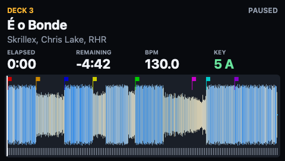
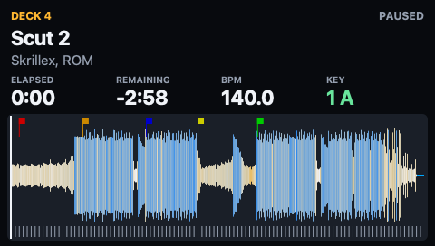

# Deck page time validation (#80, #83)

Records of how the deck page time behaved on a live djay and in replays. The page
design, data sources and limits are in [deck-pages.md](deck-pages.md). The attended
check on the S8 (#85) is recorded there too.

## Paused deck time and Four Decks (#80)

Observed on 2026-11-10 with djay Pro in English and the terminal holding
Accessibility permission. A test read `DeckMonitor` about every 0.2 s. A second
process sampled djay's play value and remaining label at 100 Hz. The layout showed
only the remaining time. Captures are in `captures/deck-pages-20261110/`, one
`-page` and one `-djay` file per check.

- **A**, before the fix. Two Decks; the user played, paused and resumed deck 1.
  djay only: a playing deck's play value stays `Active`. A paused deck's value
  alternates every 0.5 s, in phase on all decks. The remaining label changes once
  a second.
- **B**, `f76b2d1`. Two Decks, both paused, 9.4 s. Deck 1 held 27.91 s and deck 2
  held 0.70 s. Neither was reported playing.
- **C**, `f76b2d1`. Two Decks; the user played, paused and resumed deck 1, 45 s.
  Playing was reported 1.1 to 1.5 s after play. Paused was reported within 0.7 s
  of pause. After about 18 s paused the time continued from the paused position.
  Deck 2 held 0.70 s.
- **D**, `f76b2d1`. Four Decks, all paused, 9.4 s. Failed. Polls were 0.93 s
  apart. Decks 2, 3 and 4 were reported playing for 6 to 8 polls. Their time ran
  ahead by 4.6 to 8.4 s.
- **E**, `9eff1fb`. Four Decks, all paused, 16 s, 107 samples per deck. All four
  decks held their time and none was reported playing.
- **F**, `9eff1fb`. Four Decks, 75 s, 474 samples per deck. The user played and
  paused deck 3, then deck 4, then deck 3 again.
  - Decks 1 and 2 held.
  - Deck 3 was reported playing 1.2 s and 1.3 s after play. It paused 0.6 s and
    0.5 s after pause. After 32 s paused it continued from 44.04 s.
  - Deck 4 was reported playing 0.8 s after play. It paused 0.6 s after pause.
  - A poll took 0.105 s (median of 238).

`--deck N --no-window --png` on `9eff1fb` for decks 1 to 4, all paused: each page
showed title, artist, BPM, key, remaining time, waveform and cue markers (8, 7, 8
and 5 cues).

In F the page time stepped back when a playing deck was paused. On deck 3 it went
from 59.88 s to 59.04 s. Decks at the start of a track showed 0.04 s, 0.34 s and
0.70 s. Both come from the cut-off label (#83). They were not fixed at that
revision; see "Time inside djay's second (#83)" below.

A first recording of F was lost before it was saved; the user repeated the steps.

Not exercised: French labels on a live djay, a layout that shows the elapsed time,
a changed pitch, scratching and looping, and the 10 Hz preview window.

Automated: `swift test --package-path macos` covers these checks:

- label parsing (English and French)
- splitting one walk by deck
- time interpolation
- debouncing, including a blink sampled once per period
- analysis decoding against a real trimmed `.djayMetadata` fixture
- deck tracking
- the page render, including the empty state

These checks sent nothing to the S8. The attended run is in
[deck-pages.md](deck-pages.md).

## Time inside djay's second (#83)

Automated: checked on 2026-11-10 at `0c3264e` with `swift test --package-path
macos`. Both test classes feed `DeckTracker` a poll every 0.25 s at five poll
phases. They read the page every 0.1 s.

`DeckTimeReplayTests` replays the djay side of capture C.

- The capture is `captures/deck-pages-20261110/c-two-decks-play-djay.txt.gz`.
- It is copied to `macos/DjayDecksTests/Fixtures/`.
- The true position comes from the moments the remaining label moved.

| Deck 1 in capture C                     | Page in the replay, over the five poll phases                                                            |
| --------------------------------------- | -------------------------------------------------------------------------------------------------------- |
| First play (label moved at 9.48 s)      | PLAYING at 9.1 to 9.3 s. The time moved forward once by 0.5 s, from the middle of the second to its end. |
| Playing, from 0.25 s after a label move | 0 to 0.25 s behind djay, never ahead.                                                                    |
| Pauses at 21.41 s and 42.88 s           | PAUSED 0.0 to 0.3 s later. No step back.                                                                 |
| Paused                                  | Within 0.25 s of the paused position.                                                                    |
| Resumes at 40.00 s and 47.87 s          | PLAYING 0.1 to 0.45 s later. The time moved forward once by 0 to 0.3 s.                                  |
| Whole capture                           | The page second equals djay's label at the last poll, and the time never steps back.                     |

Deck 2 of capture C stood at the start of its track and showed 0.70 s before the
fix. In the replay it shows 0 s elapsed for the whole capture.

For comparison, the stream log of `b-play` before the fix has steps back of 0.48 s
and 0.84 s on pause. It has steps forward of 0.87 s and 0.92 s on resume. That log
is from another session; see the #85 record in [deck-pages.md](deck-pages.md).

`DeckTimeSimulationTests` runs a simulated deck that cuts its label the same way.
Presses fall at other moments in the second, and the blink runs at other phases. It
holds the same bounds. It also bounds the time before playing is confirmed: at most
0.75 s ahead and at most 0.7 s plus two polls behind.

### On the S8

Run once on 2026-11-10 with `mise run s8:deck-page b-play` at `71470ad`. This is
the same code before it was rebased onto `main`. Answers and logs are in
`captures/deck-page-20261110T201431Z/`.

- `b-play`: status lines `pending`, `active`, `inactive`; exit status 0; 102
  records sent. The observer answered `y` to all four questions.
  - While deck 1 played, the left panel said PLAYING and its time moved with
    djay's.
  - On pause the left time stopped without stepping back and stood still.
  - On resume it did not jump by the length of the pause.
  - The right panel stood still.
- `c-four-decks`: status lines `pending`, `active`, `inactive`; exit status 0; 120
  records sent. The observer answered `y` to both questions.
  - Deck 3 was on the left and deck 4 on the right.
  - Each time moved only while its own deck played.
  - On pause it stopped without stepping back and stood still.

Both resume questions named one move forward of less than 1 s as known (#87).
Nothing else was reported on the panels: "everything looked good". After recovery
the panels showed the Controller Editor labels and djay reacted to the left PLAY
button.

What the stream logs show was sent (sent, not seen):

| Deck | Event                                    | Page elapsed                   |
| ---- | ---------------------------------------- | ------------------------------ |
| 1    | First PLAYING record                     | 79.41 s to 79.91 s (+0.50 s)   |
| 1    | PAUSED record                            | 91.76 s to 91.91 s (+0.15 s)   |
| 1    | First PLAYING record after 15.9 s paused | 91.91 s to 92.76 s (+0.85 s)   |
| 1    | PAUSED record                            | 111.33 s to 111.66 s (+0.33 s) |
| 2    | One record, at the start of its track    | 0.00 s                         |
| 3    | First PLAYING record                     | 80.54 s to 81.23 s (+0.69 s)   |
| 3    | PAUSED record                            | 99.22 s to 99.54 s (+0.32 s)   |
| 4    | First PLAYING record                     | 44.84 s to 45.34 s (+0.50 s)   |
| 4    | PAUSED record                            | 60.05 s to 60.09 s (+0.04 s)   |

No record stepped back. The moves when PLAYING appears, 0.50 s to 0.85 s, are the
step of #87.

Not checked: the page time against djay's true position on a live djay, a layout
that shows the elapsed label, a changed pitch, a jump, scratching and looping.
