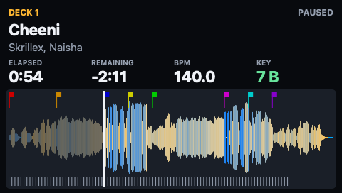
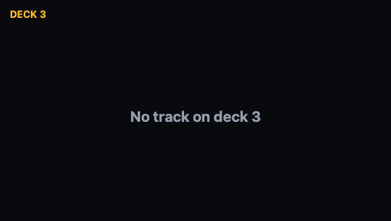

# Deck pages (#45)

A 480×272 page for one djay deck: title, artist, BPM, key, elapsed and
remaining time, play state, the overview waveform with a playhead, bar and
beat ticks, and cue markers. Nothing here is sent to the S8: the page renders
to a bitmap, a PNG or an `.s8frame` file through `S8Preview`.

## Data sources

| Data | Source | Notes |
| ---- | ------ | ----- |
| Title, artist, BPM, key, elapsed, remaining, playing | djay window through Accessibility (`DjayDecks`, polled by `DeckMonitor`) | Needs Accessibility permission for the process. Labels are English and French (`Deck n` and `Platine n`). |
| Time between AX updates | `TimeInterpolator` (ported) | Extrapolates elapsed and remaining while playing, scaled by the pitch percentage, and eases corrections. `PlayStateDebouncer` (ported) delays paused-to-playing by about 0.7 s. |
| Duration, cue points | Read-only `DjayLibrary` snapshot (copy of `MediaLibrary.db` with `-wal` and `-shm`) | The track is matched by title and artist. Used to derive elapsed when only remaining is shown. |
| Overview waveform, 3-band samples, beats, bars | `~/Library/Group Containers/VJXTL73S8G.com.algoriddim.userdata/Library/Application Support/Algoriddim/Metadata/**/<trackID>.djayMetadata` | Binary plist. Amplitude: zlib bytes at `lowRateWaveFinalSampleRate`. Bands: zlib, bfloat16 triples at `lowRateSampleRate`, normalised by the global peak. Beats: zlib big-endian float32 seconds. Bars: every 4th beat starting at `firstDownBeatIndex % 4`. |

djay's live database and cache are only read; the snapshot is a temporary copy.

## `DeckSnapshot` (schema 1, `S8Views`)

`schema`, `deck`, `capturedAt`, `title`, `artist`, `bpm` (string as djay shows
it), `key` (string as djay shows it), `elapsed`, `remaining`, `duration`
(seconds), `playing`, `notice`, `analysis` (`amplitude` 0–255, `amplitudeRate`,
`bands` as three 0–255 channels, `bandRate`, `beats`, `bars`, `bpm`) and `cues`
(`time`, `name`, `color`). Optional fields are omitted when unknown.

Empty states: no track shows "No track on deck n" (or `notice`, for example
"djay is not running" or "Accessibility permission needed"); a track without
analysis shows its header and "No analysis for this track". Beat ticks are
drawn only when beats are at least 5 px apart; bar ticks always are.

## Layout and dependencies

`S8Views` holds `DeckSnapshot` and `DeckPanelRenderer` and stays free of
Accessibility and file access. `DjayDecks` depends on `S8Views` and
`DjayLibrary` and builds snapshots directly, so no adapter type is needed.
Attribution for ported files is in `macos/DjayDecks/NOTICE` and
`macos/DjayDecks/README.md` (ported versus new files).

## Limits

- Accessibility is view-dependent: with djay's library expanded or in other
  layouts the time labels can be missing. A remaining-only layout derives
  elapsed from the library duration.
- The cached waveform is about 2–11 samples per second (the sampled tracks:
  5.1–5.6 colour samples/s and about 20–22 amplitude samples/s). It is an
  overview of the whole track, not a zoomed scrolling waveform.
- Band channel 0 is bass (confirmed in the prototype); channels 1 and 2 are
  assumed mid and treble and are unverified. The page draws the amplitude
  envelope tinted by the bands.
- The key stored in the analysis blob is not decoded; the AX key is used.
- Cue points come from `mediaItemUserData` (`cuePoints`). Unit tests cover
  synthetic data; the live run showed 8 cues, not compared with djay's list.
- Playback position is a prediction between AX updates; it can drift by the
  AX update interval and while scratching or looping.
- Decks 3 and 4: see the validation record.

## Run the preview

```sh
swift run --package-path macos S8Preview macos/S8ViewsTests/Fixtures --deck 1
swift run --package-path macos S8Preview macos/S8ViewsTests/Fixtures --deck 1 --no-window --png /tmp/deck
swift run --package-path macos S8Preview macos/S8ViewsTests/Fixtures --deck-snapshot deck.json
```

`--deck N` replaces the right panel with live deck N and refreshes at 10 Hz;
`f` (or `--png`/`--frames`) also writes `deck-N.png`, `deck-N.json` (a
`DeckSnapshot`, reusable with `--deck-snapshot`) and `deck-N.s8frame`.

## Validation record

Observed on 2026-11-10 with djay Pro running and the terminal holding
Accessibility permission, using `--deck 1 --no-window --png /tmp/deck`:

- Deck 1 was loaded and paused. Populated: title "Cheeni", artist, BPM
  "140.0", key "7 B", elapsed 54.9 s, remaining 131 s, duration 185.9 s,
  playing false, 8 cue points, amplitude (22.05 samples/s), 3 band channels
  (5.56 samples/s), beats, bars. The playhead and cue markers matched djay's
  position and cue list on screen to the eye only; no frame-accurate comparison.

  

- Decks 2, 3 and 4 produced no title or time through the same labels, so the
  empty page was rendered.

  

  This cannot tell an empty deck from a deck that is not in djay's current
  layout, and how a four-deck layout appears in AX was not determined.
  djay's layout was not changed and no track was loaded.
- Playing state, live time extrapolation and the 10 Hz window refresh were
  not exercised on live data (the deck was paused); they are covered by unit
  tests only.

Automated: `swift test --package-path macos` covers label parsing (English and
French), time interpolation and debouncing, analysis decoding against a real
trimmed `.djayMetadata` fixture, deck tracking and the page render including
the empty state. Not verified: anything on the S8 hardware, frame upload of
deck pages, and 4-deck AX labels.
