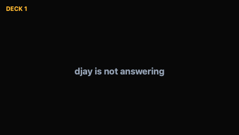
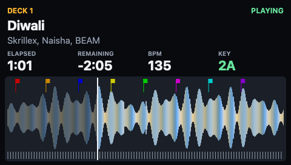

# Deck pages (#45)

A 480×272 page for one djay deck. It shows title, artist, BPM, key, elapsed and
remaining time, play state, the overview waveform with a playhead, bar and beat
ticks, and cue markers. Nothing here is sent to the S8. The page renders to a
bitmap, a PNG or an `.s8frame` file through `S8Preview`.

<?toc?>

- [Data sources](#data-sources)
  - [Accessibility labels](#accessibility-labels)
  - [Play state](#play-state)
  - [Time between AX updates](#time-between-ax-updates)
  - [Library snapshot](#library-snapshot)
  - [Analysis file](#analysis-file)
- [DeckSnapshot (schema 1, S8Views)](#decksnapshot-schema-1-s8views)
  - [Empty states](#empty-states)
- [Layout and dependencies](#layout-and-dependencies)
- [Limits](#limits)
  - [Accessibility view](#accessibility-view)
  - [djay not answering](#djay-not-answering)
  - [Bars](#bars)
  - [Waveform resolution](#waveform-resolution)
  - [Band channels and key](#band-channels-and-key)
  - [Cue colours](#cue-colours)
  - [Cue points](#cue-points)
  - [Reload while a track stays loaded](#reload-while-a-track-stays-loaded)
  - [Time accuracy](#time-accuracy)
  - [Decks not shown (#93)](#decks-not-shown-93)
  - [Library matching (#94)](#library-matching-94)
- [Preview, stream and attended check](#preview-stream-and-attended-check)
- [Validation record](#validation-record)
  - [Deck pages on the S8 (#85)](#deck-pages-on-the-s8-85)

<?/toc?>

## Data sources

| Data                                   | Source                                          |
| -------------------------------------- | ----------------------------------------------- |
| Title, artist, BPM, key, time, playing | djay window through Accessibility (`DjayDecks`) |
| Play state                             | `PlayStateDebouncer` (ported, extended)         |
| Time between AX updates                | `TimeInterpolator` (rewritten for #83)          |
| Duration, cue points                   | Read-only `DjayLibrary` snapshot                |
| Overview waveform, bands, beats, bars  | `.djayMetadata` analysis file                   |

djay's live database and cache are only read. The snapshot is a temporary copy.

### Accessibility labels

`DeckMonitor` polls `DjayDecks`. The process needs Accessibility permission.

One poll walks the window once and splits the labels by deck number. The cost does
not grow with the number of decks: about 0.1 s was measured with four decks.

The walk covers the application's children and its focused window. With the window
in another Space the children hold only the menu bar. The focused window still
answers (#100).

Title, artist, key and BPM are read from English and French labels (`Deck n` and
`Platine n`). The time and play labels are matched in English only.

### Play state

The play button of a paused deck blinks at 1 Hz. It is lit for 0.5 s and unlit for
0.5 s. A playing deck stays lit.

- Playing is reported after the button has been lit for 0.7 s. Only samples at
  most 0.45 s apart count, because the unlit half of a blink fits in a longer gap.
- Playing is reported at once when the time label moves one second in the play
  direction while the button is lit.
- Paused is reported on the first unlit sample.

### Time between AX updates

djay cuts the fraction off a time label. A label names a whole second and not a
moment. The page time always stays inside the second of the label last read.

- A paused label rests at the middle of its second.
- A remaining label equal to the track length, cut to a whole second, rests at the
  track start. Elapsed is then 0.
- While the debounced state is playing, the time counts on, scaled by the pitch
  percentage. It waits at the end of the label's second until the label moves.
- A label that moves one second in the play direction marks the boundary between
  the two seconds.
- Any other label change is a jump. The time rests at the middle of the new second.
- On pause the counted time stays.
- When playing is confirmed, the time since the first lit sample is added.

### Library snapshot

The snapshot is a copy of `MediaLibrary.db` with its `-wal` and `-shm` files. The
track is matched by title and artist. The track length read from the deck labels
picks among entries with one title (see [Limits](#limits)). The duration is used to
derive elapsed when only remaining is shown.

### Analysis file

The file is a binary plist at `~/Library/Group Containers/VJXTL73S8G.com.algoriddim.userdata/`
`Library/Application Support/Algoriddim/Metadata/**/<trackID>.djayMetadata`.

- Amplitude: zlib bytes at `lowRateWaveFinalSampleRate`.
- Bands: zlib, bfloat16 triples at `lowRateSampleRate`, normalised by the global
  peak.
- Beats: zlib big-endian float32 seconds.
- Bars: every 4th beat counting from `firstDownBeatIndex` (see Limits for gaps).

## `DeckSnapshot` (schema 1, `S8Views`)

The fields are:

- `schema`, `deck`, `capturedAt`, `title`, `artist`
- `bpm` and `key`, both as strings as djay shows them
- `elapsed`, `remaining` and `duration`, in seconds
- `playing` and `notice`
- `analysis`: `amplitude` (0–255), `amplitudeRate`, `bands` (three 0–255
  channels), `bandRate`, `beats`, `bars` and `bpm`
- `cues`: `time`, `name` and `color`

Optional fields are omitted when unknown.

### Empty states

- A deck that djay shows without a track says "No track on deck n".
- A deck that djay's current view does not show says "Deck n is not shown in djay"
  (#93).
- Other notices are, for example, "djay is not running" or "Accessibility
  permission needed".
- A track without analysis shows its header and "No analysis for this track".

Beat ticks are drawn only when beats are at least 5 px apart. Bar ticks always are.

## Layout and dependencies

`S8Views` holds `DeckSnapshot` and `DeckPanelRenderer`. It stays free of
Accessibility and file access.

`DjayDecks` depends on `S8Views` and `DjayLibrary`. It builds snapshots directly,
so no adapter type is needed.

Attribution for ported files is in `macos/DjayDecks/NOTICE`. The ported and new
files are listed in `macos/DjayDecks/README.md`.

## Limits

### Accessibility view

Accessibility is view-dependent. With djay's library expanded or in other layouts
the time labels can be missing. A remaining-only layout derives elapsed from the
library duration.

### djay not answering

djay can fail to answer an Accessibility read while it is busy. The system then
reports "cannot complete". If the process holds permission, the page shows "djay is
not answering" instead of the track. This is a notice page like the others:
centred text, in the same position as "No track on deck n".

- The deck keeps its track, library entry (analysis, cues) and last reading. No
  new library lookup is needed.
- The time does not count on while waiting.
- The play-state debouncer and time interpolator start fresh with the next answer.
  The play state is confirmed again from new samples.
- The notice goes away with the first good read.
- A missing permission shows "Accessibility permission needed". So does "cannot
  complete" without permission. A missing djay shows "djay is not running". Both
  reset the deck.
- Each read waits at most 3 s. The sidebar reader uses the same limit.

This was read from code and not seen in djay. The page below is what
`S8Host --screens --deck 1` would send. It was made with `S8Host --replay` from a
deck snapshot that holds only the notice, and decoded by `s8-screen-png`.

### Bars

Bars come from `firstDownBeatIndex` and the beat list. djay's own bar lines were
not compared. The index may be negative or beyond the list. The bar phase is the
index modulo 4, mathematically.

Where the list skips beats, the skipped beats are counted so bars keep their phase.
The gap is divided by the median of the 9 beat intervals around it. This is a local
window, so a tempo change inside a track does not distort the count. The result is
rounded.

A gap counts as skipped beats only if both of these hold:

- It is at least 1.5 intervals.
- It is within 0.25 interval of a whole number.

Any other irregular spacing (a restarted grid) is counted as one beat.

The one real analysis file in the tests has 478 beats. Their spacing is
0.417–0.437 s at 140 BPM, so it has no gaps and its bars are unchanged. Gap
handling is covered by synthetic lists only.

### Waveform resolution

The cached waveform is about 2–11 samples per second. The sampled tracks gave
5.1–5.6 colour samples/s and about 20–22 amplitude samples/s. It is an overview of
the whole track, not a zoomed scrolling waveform.

### Band channels and key

Band channel 0 is bass (confirmed in the prototype). Channels 1 and 2 are assumed
mid and treble and are unverified. The page draws the amplitude envelope tinted by
the bands.

The key stored in the analysis blob is not decoded. The AX key is used.

### Cue colours

A cue point's colour is the `color` djay stores. djay stores none for many cues:
about half of those numbered 2 to 8 in one real library. The page then takes the
default for the cue's number. A cue with no number is cue 1.

| Cue | Colour  | Hex       |
| --- | ------- | --------- |
| 1   | red     | `#CC0000` |
| 2   | orange  | `#CC8800` |
| 3   | blue    | `#0000CC` |
| 4   | yellow  | `#CCCC00` |
| 5   | green   | `#00CC00` |
| 6   | magenta | `#CC00CC` |
| 7   | teal    | `#00CCCC` |
| 8   | purple  | `#8800CC` |

In that library each default is the stored colour of all but a few of the cues of
its number that have one. A cue numbered above 8 keeps the amber fallback.

### Cue points

Cue points come from `mediaItemUserData` (`cuePoints`). Unit tests cover synthetic
data. On the S8 the flags of two tracks were compared with djay's cue points by eye
([deck-data-validation.md](deck-data-validation.md), row 3).

### Reload while a track stays loaded

Cue points and analysis are read again while the track stays on the deck, as
issues #92 and #95 changed it. Before that they were read once per track. A cue
point set later got no flag on the S8 (row 11 of the same record).

Every 5 s per deck with a track, the monitor asks the catalog again. A look costs:

- a directory listing
- until the file is found, one plist read for the analysis (kept once found)
- two `stat` calls, at most once per 5 s: the modification date and size of
  `MediaLibrary.db` and `MediaLibrary.db-wal`

The database is copied only when those changed since the last load. The copy runs
on the catalog's own background queue, so the 0.25 s deck poll never waits for it.
The first load is synchronous. A failed reload keeps the previous library and is
tried again at the next check. Adopting a refreshed entry for the same track does
not touch the position or the play state.

From the write of a change to the page takes at most about 10 s:

- up to 5 s until the files are checked
- the reload, about 0.4 s measured for a 34.5 MB database
- up to 5 s until the next look

Seen against djay once ([captures](captures/djay-check-20261111T003350Z/README.md)):

- A removed and a moved cue point reached the page 4.4 s and about 6 s after djay
  wrote its library.
- The analysis of a track djay analysed by itself after the load reached the page
  4.6 s after its file was written.

Not measured: how long after the action in djay the write to disk comes. The
observer gave no times for the cue points. The analysis was reported as "1-2
seconds", and its file was written 0.7 s after the track was on the page. A change
djay keeps only in memory cannot appear on the page.

### Time accuracy

djay shows whole seconds. The page knows the position exactly only at the moment a
label moves. In the tests, with a poll every 0.25 s:

- A playing deck is 0 to 0.25 s behind djay once a poll has seen its label move.
  It is never ahead.
- A deck paused after it played is within 0.25 s.
- A deck that has not played since it was first read, or that jumped, is within
  0.5 s.

Scratching and looping are not modelled.

From the press of play until playing is confirmed, the time stands still. It then
moves forward once by the time played, less than 1 s (#87).

The track start is recognised only when the track length is known from the
library. The remaining label is taken as the remaining time cut to a whole second.
This matches capture C of the #80 record
([deck-pages-time-validation.md](deck-pages-time-validation.md)).

### Decks not shown (#93)

djay exposes only the decks its current view shows
([captures](captures/one-deck-view-20261111T000921Z/README.md)). Two Decks exposes
decks 1 and 2. Four Decks exposes all four. One Deck exposes one deck.

Which deck One Deck exposes is not settled:

- In the captures, a scripted cue click on deck 2 was followed by deck 2. A
  scripted press on a deck 1 control was followed by deck 1.
- In the check against djay, deck 1 was shown after cue points set by mouse and a
  track load on deck 2
  ([captures](captures/djay-check-20261111T003350Z/README.md)).
- Loading a track or opening the Deck menu did not change it in the captures.
- A track dragged in while in One Deck went to the deck shown.

A deck that is not shown keeps its track in djay. Its page says "Deck n is not
shown in djay". It keeps the track, library entry and last reading, as for "djay is
not answering" above. The page returns with the first read that has the deck again,
without a new library lookup. The time of a hidden deck is not known while it is
hidden, also when it plays.

Seen against djay once, with deck 2 hidden and paused. Not seen on the S8.

Not looked at:

- the shown deck changing while One Deck stays open
- One Deck right after djay starts
- the labels of a shown deck without a track (the "No track" case is covered by
  fake labels only)

### Library matching (#94)

Library entries are matched by title and artist. When no entry has the deck's
artist text, the entries with the title are used. The deck's length decides among
them.

- With both time labels, the length is elapsed plus remaining. It is accepted
  within 2 s, because each label is cut to a whole second.
- With only the remaining label, the track must be at least remaining minus 1 s
  long.
- An entry without a stored duration is never ruled out by length.
- Entries of the artist that matches are kept even if their length disagrees with
  the labels.

A title-only match gives no entry in either of these cases:

- No entry fits the length.
- The entries that fit differ by more than 2 s in stored duration.

The same track twice in the library (durations within 2 s) still gives the first
entry that has an analysis, else the first.

A deck whose track cannot be told apart shows its djay labels with "No analysis for
this track" and no cue flags. This avoids showing another track's length, cues and
waveform.

The length cannot separate entries in this case: one title, different artist text
on the deck and in the library, and lengths within 2 s of each other. The page then
takes the first of them that has an analysis, which may be the wrong one.

Unit tests cover these cases through `DjayLibrarySnapshot` and `LibraryCatalog`
with synthetic libraries, and through `DeckMonitor` with fake labels. This was not
seen in djay.

## Preview, stream and attended check

The commands for `S8Preview` (`--deck`, `--stream`) and the plan for the attended
check on the S8 (#85) are in
[deck-pages-attended-check.md](deck-pages-attended-check.md). The result of that
check is recorded below.

## Validation record

Observed on 2026-11-10 with djay Pro running and the terminal holding Accessibility
permission, using `--deck 1 --no-window --png /tmp/deck`:

- Deck 1 was loaded and paused. Populated: title "Cheeni", artist, BPM "140.0",
  key "7 B", elapsed 54.9 s, remaining 131 s, duration 185.9 s, playing false, 8
  cue points, amplitude (22.05 samples/s), 3 band channels (5.56 samples/s),
  beats, bars. The playhead and cue markers matched djay's position and cue list
  on screen to the eye only. There was no frame-accurate comparison.

  

- Decks 2, 3 and 4 produced no title or time through the same labels, so the empty
  page was rendered.

  

  djay's layout was not changed and no track was loaded. The record in
  [deck-pages-time-validation.md](deck-pages-time-validation.md) covers loaded
  decks 2, 3 and 4.

- Playing state, live time extrapolation and the 10 Hz window refresh were not
  exercised on live data, because the deck was paused. The same record covers the
  playing state and the extrapolation.

### Deck pages on the S8 (#85)

Run once on 2026-11-10 at `23b8d28` with `mise run s8:deck-page`. It followed the
plan in [deck-pages-attended-check.md](deck-pages-attended-check.md). The
observer's answers are in `captures/deck-page-20261110T192200Z/notes.txt`. The
same folder holds the bridge output and the stream log of each step.

Each step ran with status lines `pending`, `active`, `inactive` and exit status 0.

- `a-paused`: 2 records sent. The observer answered `y` to all three questions.
  - The left panel showed deck 1 and the right panel deck 2, with title, time,
    waveform and PAUSED.
  - Both times and playheads stood still for the 20 s.
  - Both panels went black at the end.
- `b-play`: 117 records sent. The observer answered `y` to the first question:
  while deck 1 played, the left panel said PLAYING and its time moved with djay's.
  - To the question whether the paused time stood still and went on without a
    jump by the length of the pause, the answer was: "on resume, there was a small
    jump in the time on the S8 display".
  - The runner took that as a fault and stopped. The question about the right
    panel was not asked.
- `c-four-decks`: not run in this run; see the second run below.

After recovery the panels showed the Controller Editor labels and djay reacted to
the left PLAY button.

What the stream log of `b-play` shows was sent for deck 1 (sent, not seen):

| Time in step     | Event                             | Page elapsed      |
| ---------------- | --------------------------------- | ----------------- |
| 0.0 s to 11.1 s  | Paused, one record                | 47.91 s           |
| 11.1 s           | First PLAYING record              | 48.78 s (+0.87 s) |
| 25.0 s           | Last PLAYING record               | 62.39 s           |
| 25.1 s           | PAUSED record                     | 61.91 s (-0.48 s) |
| 25.1 s to 37.1 s | Paused for 12.0 s, no record      | 61.91 s           |
| 37.1 s           | First PLAYING record after resume | 62.83 s (+0.92 s) |
| 52.8 s           | Last PLAYING record               | 78.75 s           |
| 52.9 s           | PAUSED record                     | 77.91 s (-0.84 s) |

Deck 2 was sent once, at 0.70 s, and never again.

Reading of the reported jump, from the log and not confirmed by the observer.
The step on resume was 0.92 s after a pause of 12.0 s. So it is not the jump by the
length of the pause that #80 fixed. It has the size of the step #83 describes when
play is confirmed. The steps back on pause are the cut-off label of #83. The
observer saw it on the panel. Whether a step of that size is acceptable is not
decided.

After this run the runner asks the paused time and the resume in separate
questions and names the expected step.

Second run on 2026-11-10 at `d27bf56` with `mise run s8:deck-page c-four-decks`,
which skips the first two steps. Answers and logs are in
`captures/deck-page-20261110T193343Z/`.

- `c-four-decks`: status lines `pending`, `active`, `inactive`; exit status 0; 91
  records sent. The observer answered `y` to both questions.
  - The left panel showed deck 3 and the right panel deck 4.
  - Each time moved only while its own deck played and stood still while it was
    paused.
  - The question named one step of up to about 1 s when PLAYING appears as
    expected.
  - Nothing else was reported on the panels.

After recovery the panels showed the Controller Editor labels and djay reacted to
the left PLAY button.

Not checked on the S8: whether the right panel stood still during `b-play`, and a
second run of `b-play` with the reworded questions.

The time handling is validated further in
[deck-pages-time-validation.md](deck-pages-time-validation.md).
