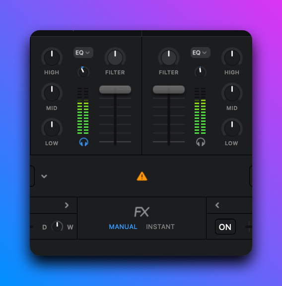
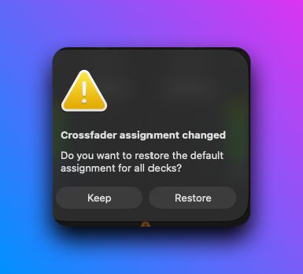

# S8 default Djay mapping

The bridge generates `Kontrol S8 Bridge.djayMidiMapping` for the virtual MIDI
endpoint `Kontrol S8 MIDI Full`. Every address comes from
`src/s8/catalog.rs`; this page lists the default layout that catalog produces.

This is the working default layout. It assumes the S8 is the only controller
Djay uses. A second layout based on Evan's mapping is tracked in
gootecks/S4MK3-HID-MIDI-BRIDGE issue #65. The mapping has no screen feedback;
its LED feedback is in [LED feedback](#led-feedback). Nothing here is
hardware-verified until the attended check.

<?toc?>

- [Channels and message types](#channels-and-message-types)
- [Deck controls](#deck-controls)
  - [Notes](#notes)
  - [CCs](#ccs)
- [Pads](#pads)
- [FX units](#fx-units)
- [Mixer (channel 5)](#mixer-channel-5)
  - [Mixer CCs](#mixer-ccs)
  - [Mixer notes](#mixer-notes)
- [Crossfader assign (channel 5, notes)](#crossfader-assign-channel-5-notes)
- [Deck select (channel 6, notes)](#deck-select-channel-6-notes)
- [LED feedback](#led-feedback)
  - [Feedback addresses](#feedback-addresses)
  - [What each LED shows](#what-each-led-shows)
  - [Pad colours](#pad-colours)
  - [Touchstrip banks](#touchstrip-banks)
  - [Clearing and old mappings](#clearing-and-old-mappings)
  - [Write failures and limits](#write-failures-and-limits)
  - [Not verified on the S8](#not-verified-on-the-s8)
- [Hardware-local controls](#hardware-local-controls)
- [Unassigned controls](#unassigned-controls)

<?/toc?>

## Channels and message types

Channels below are one-based, as Djay shows them. The plist stores them
zero-based.

| Scope                 | Channel |
| --------------------- | ------- |
| Decks A-D             | 1-4     |
| Mixer                 | 5       |
| Deck select           | 6       |
| Decks A-D, Shift held | 9-12    |

Notes are message type 1; CCs are type 3. Number is the note or CC number.

Each deck side (left and right) sends on the channel of the deck it currently
controls. The DECK button switches a side between A/C or B/D and sends the
deck-select note. A control that has a Shift row uses it while Shift is held;
a control without one keeps its base row. Shift rows share the number of their
base row and sit on channel + 8.

A control can run several Djay actions. The bridge still sends one message;
the mapping binds that address to each action, and Djay's MIDI configuration
lists it once per action.

## Deck controls

Channel is the deck's channel (1-4), or 9-12 for Shift. Both sides send the
same numbers.

### Notes

| Control              | No.   | Base                                              | Shift                  |
| -------------------- | ----- | ------------------------------------------------- | ---------------------- |
| PLAY                 | 0     | `playPause`                                       |                        |
| CUE                  | 1     | `cuePositionOrJumpConsideringPlayState1`          | `gotoZero`             |
| SYNC                 | 2     | `bpmSync`                                         |                        |
| FLUX                 | 4     | `deckSlipToggle`                                  | `reverseHold`          |
| Loop encoder press   | 6     | `autoLoopOnOff`                                   | `reloop`               |
| Touchstrip touch     | 7     | `scratchingMode`                                  | `jogSeekMode`          |
| BACK                 | 9     | `musicLibrary.toggleLibrarySource`                | `libraryBack`          |
| Browse encoder press | 12    | `musicLibrary.load{deck}`                         | `toggleLibraryVisible` |
| EDIT                 | 13    | `musicLibrary.togglePreview`                      |                        |
| FX SELECT            | 14    | `musicLibrary.toggleLibraryVisible`               |                        |
| CAPTURE              | 22    | `recordSample`                                    |                        |
| HOTCUE               | 25    | `padModeHotCue`                                   | `padModeBounceLoop`    |
| LOOP                 | 26    | `looper.toggleLooperShown`                        |                        |
| FREEZE               | 27    | `padModeSlicer`                                   | `slicerLoopModeToggle` |
| REMIX                | 28    | `padModeSampler` and `sampler.toggleSamplerShown` |                        |
| Stem ON 1-4          | 56-59 | `unmixerFourTrackChannel{1-4}Muted`               | `...Channel{1-4}Solo`  |

Unqualified names are `turntable{deck}.` actions. These are
`musicLibrary.` actions:

- `libraryBack`
- `toggleLibrarySource`
- `load{deck}`, which loads into the sending deck
- `toggleLibraryVisible`
- `togglePreview`

Djay names `toggleLibrarySource` "Switch Library Table", `libraryBack`
"Switch Back" and `toggleLibraryVisible` "Toggle Library Expanded".

REMIX therefore toggles Djay's sampler view each time it is pressed
(`toggleSamplerShown`, "Toggle Sampler"). `sampler.showSampler`, which has no
title in Djay's MIDI configuration, did not open the sampler in the second
attended check and is not used.

LOOP toggles Djay's Looper view in the same way and does not change the pad
layer. The Looper's own pad triggers are not mapped.

### CCs

| Control        | No.   | Type             | Base                                   | Shift                                  |
| -------------- | ----- | ---------------- | -------------------------------------- | -------------------------------------- |
| Loop encoder   | 1     | relative         | `autoLoopDurationRotary`               | `skipRotary`                           |
| Browse encoder | 3     | relative         | `musicLibrary.libraryRotary` (flipped) | `musicLibrary.sectionRotary` (flipped) |
| Touchstrip     | 5     | rotary-absolute  | `scratchingMove` (flipped)             | `jogSeekMove`                          |
| Stem fader 1-4 | 48-51 | absolute, pickup | `unmixerFourTrackChannel{1-4}Volume`   |                                        |

The touchstrip sends its position, 1-1024, as the 7-bit value
`(position - 1) >> 3`, once per change, and its touch note while a finger is
on it. Djay turns successive values into motion (`rotary-absolute`), and the
touch note switches scratching on (`scratchingMode`) or, with Shift, seeking
(`jogSeekMode`). A touch keeps the deck and layer it started on.
NIHardwareAgent sends the same value for the Controller Editor template, and
the user reports the same feel as with that setup
([translator-validation.md](translator-validation.md#touchstrip)). Each
layer has its own sensitivity and acceleration; the tuned values are in the
catalog.

## Pads

The pad layer is chosen by HOTCUE, Shift + HOTCUE, FREEZE and REMIX. Each
switches the bridge's pad layer for its side and sends its pad-mode note
(25, 27 and 28 above; Shift + HOTCUE sends 25 on the Shift channel), so
Djay's pad view follows. Pad numbers 1-8 map to the note numbers shown. All
pad rows are notes on the deck channel.

| Mode           | Pads 1-8 | Base action                                                                 | Shift action       |
| -------------- | -------- | --------------------------------------------------------------------------- | ------------------ |
| HOTCUE         | 40-47    | `cueOrJumpIfAlreadySet1-8` (hot cues)                                       | `clearCuePoint1-8` |
| Shift + HOTCUE | 64-71    | `bounceLoop...BeatInterval`, 1/32 beat (pad 1) to 4 beats (pad 8), held     | none               |
| FREEZE         | 72-79    | `slicer8Slice1-8` (Slicer)                                                  | none               |
| REMIX          | 48-55    | `sampler.turntable{bank}.player1-8.playingConsideringHoldSetting` (sampler) | `...paused`        |

Shift+FREEZE (note 27 on the Shift channel) toggles slicer loop mode. Decks A
and C use sampler bank 1; decks B and D use bank 2.

## FX units

Each unit targets the deck chosen by its mixer-channel FX buttons, and sends
on that deck's channel. The right unit has its own numbers so both units can
target the same deck. Buttons and dials 1-3 are Djay's three effect slots;
button 4 switches the deck's FX on or off and dial 4 is dry/wet for all three
slots.

| Control      | Left unit | Right unit | Base                                                 | Shift           |
| ------------ | --------- | ---------- | ---------------------------------------------------- | --------------- |
| FX 1 (notes) | 32        | 36         | `fx1Enabled`                                         | `fx1SelectNext` |
| FX 2 (notes) | 33        | 37         | `fx2Enabled`                                         | `fx2SelectNext` |
| FX 3 (notes) | 34        | 38         | `fx3Enabled`                                         | `fx3SelectNext` |
| FX 4 (notes) | 35        | 39         | `fxActive`                                           |                 |
| Dial 1 (CC)  | 32        | 40         | `fx1ParameterValue`                                  |                 |
| Dial 2 (CC)  | 33        | 41         | `fx2ParameterValue`                                  |                 |
| Dial 3 (CC)  | 34        | 42         | `fx3ParameterValue`                                  |                 |
| Dial 4 (CC)  | 35        | 43         | `fx1WetDryValue`, `fx2WetDryValue`, `fx3WetDryValue` |                 |

Dial 4 sends one CC that the mapping binds to all three dry/wet actions. All
dials use pickup.

## Mixer (channel 5)

### Mixer CCs

| Control           | No.   | Action                               |
| ----------------- | ----- | ------------------------------------ |
| GAIN A-D          | 0-3   | `turntable{1-4}.gain`                |
| EQ HI A-D         | 4-7   | `turntable{1-4}.highEQ`              |
| EQ MID A-D        | 8-11  | `turntable{1-4}.midEQ`               |
| EQ LOW A-D        | 12-15 | `turntable{1-4}.lowEQ`               |
| Channel fader A-D | 16-19 | `mixer.lineVolume{1-4}`              |
| Crossfader        | 20    | `mixer.crossfade`                    |
| FILTER A-D        | 21-24 | `turntable{1-4}.filter`              |
| Tempo encoder     | 26    | `turntableSelected.speed` (relative) |
| CUE VOL           | 25    | `mixer.monitorLevel`                 |
| CUE MIX           | 27    | `mixer.monitorMix`                   |
| BOOTH             | 28    | `mixer.boothLevel`                   |
| MAIN              | 29    | `mixer.masterLevel`                  |

Mixer CCs do not use pickup.

### Mixer notes

| Control       | No. | Action                         |
| ------------- | --- | ------------------------------ |
| CUE (PFL) A-D | 0-3 | `mixer.monitorActive{1-4}`     |
| MIC           | 4   | `microphone.active`            |
| MIC 2         | 5   | none; assign it in Djay        |
| SNAP          | 6   | none; assign it in Djay        |
| QUANTIZE      | 7   | `application.quantizeToggle`   |
| TEMPO button  | 26  | `turntableSelected.resetSpeed` |

MIC 2 and SNAP send their notes so that Djay's MIDI configuration can learn
them; the generated mapping has no entry for either. Djay names
`application.quantizeToggle` "Toggle Quantize".

## Crossfader assign (channel 5, notes)

One note per channel and switch position, sent when the switch moves.

| Channel | Left | Middle | Right |
| ------- | ---- | ------ | ----- |
| A       | 80   | 81     | 82    |
| B       | 83   | 84     | 85    |
| C       | 86   | 87     | 88    |
| D       | 89   | 90     | 91    |

Actions are `mixer.crossfadeAssignment{1-4}Left`, `...Through` and `...Right`.

Observed in the third attended check: with any assign switch away from the
middle, moving the crossfader made Djay show a warning icon in its mixer. It
also showed the dialog "Crossfader assignment changed", which offers to keep
the assignment or restore the default for all decks. With all four switches in
the middle neither appears. In the fourth check the same dialog appeared on
the first button press after the bridge started. That is the report in which
the bridge sends the four switch positions (all middle at the time). The cause
is not established.

## Deck select (channel 6, notes)

Sent by a DECK button for the deck its side switches to.

| Deck | No. | Action                           |
| ---- | --- | -------------------------------- |
| A    | 0   | `application.turntable1Selected` |
| B    | 1   | `application.turntable2Selected` |
| C    | 2   | `application.turntable3Selected` |
| D    | 3   | `application.turntable4Selected` |

## LED feedback

The bridge can light the deck LEDs from what Djay reports back. It is off by
default, and without the flag nothing is written to the controller:

       cargo run --locked -- --device s8 --midi full --s8-leds

`--s8-leds` needs `--midi` and the S8. The bridge then opens the destination
`Kontrol S8 MIDI Full` that the mapping's `outputs` feed and decodes the
messages. It combines them with its own control state and writes the deck
reports `0x80` (left) and `0x81` (right). Report framing is in `led-output.md`.
The code is in `src/s8/`: `catalog/outputs.rs`, `feedback.rs`,
`led_state.rs`, `leds.rs` and `led_output.rs`.

### Feedback addresses

Djay returns a control's state on the control's own address. These are the
embedded `output` entries: one per deck channel 1-4, message type 1 (note),
on the base row of a deck-scope note. The generator adds one for each note
that `embedded_number` accepts (0-4, 6, 8, 15-19 and 32-63).

| Number | Control            | Djay key path                                                       | Range |
| ------ | ------------------ | ------------------------------------------------------------------- | ----- |
| 0      | PLAY               | `turntable{deck}.playPause`                                         | 0-127 |
| 1      | CUE                | `turntable{deck}.cuePositionOrJumpConsideringPlayState1`            | 0-127 |
| 2      | SYNC               | `turntable{deck}.bpmSync`                                           | 0-127 |
| 4      | FLUX               | `turntable{deck}.deckSlipToggle`                                    | 0-127 |
| 6      | Loop encoder press | `turntable{deck}.autoLoopOnOff`                                     | 0-127 |
| 32-34  | Left FX 1-3        | `turntable{deck}.fx{1-3}Enabled`                                    | 0-127 |
| 35     | Left FX 4          | `turntable{deck}.fxActive`                                          | 0-127 |
| 36-38  | Right FX 1-3       | `turntable{deck}.fx{1-3}Enabled`                                    | 0-127 |
| 39     | Right FX 4         | `turntable{deck}.fxActive`                                          | 0-127 |
| 40-47  | Pads 1-8, HOTCUE   | `turntable{deck}.cueOrJumpIfAlreadySet{1-8}`                        | token |
| 48-55  | Pads 1-8, REMIX    | `sampler.turntable{bank}.player{1-8}.playingConsideringHoldSetting` | 0-127 |
| 56-59  | Stem ON 1-4        | `turntable{deck}.unmixerFourTrackChannel{1-4}Muted`                 | 0-127 |

Rows 40-47 carry a cue colour token in the velocity, so their `output`
dictionary has no value range. The other rows have `midiMinValue` 0 and
`midiMaxValue` 127. Shift rows, other notes and every CC have no embedded
output. No LED reads PLAY's note; PLAY uses the root output below.

Three root outputs cover state no control carries. There is one per deck, on
channel 7, in the mapping's root `outputs` array. Type is 3 for CCs and 1
for notes; all have range 0-127. Generation fails if one of these addresses
is also an input.

| Deck | Playing (CC) and key path | Loaded (note) and key path          | Progress (CC) and key path            |
| ---- | ------------------------- | ----------------------------------- | ------------------------------------- |
| A    | 4, `turntable1.playing`   | 0, `turntable1.song.loadingSuccess` | 8, `turntable1.display.songProgress`  |
| B    | 5, `turntable2.playing`   | 1, `turntable2.song.loadingSuccess` | 9, `turntable2.display.songProgress`  |
| C    | 6, `turntable3.playing`   | 2, `turntable3.song.loadingSuccess` | 10, `turntable3.display.songProgress` |
| D    | 7, `turntable4.playing`   | 3, `turntable4.song.loadingSuccess` | 11, `turntable4.display.songProgress` |

A note-on above velocity 0 on a deck's loaded address marks it loaded. Any
other state clears that deck's cue colours, playing and progress until Djay
reports them again. A sampler row reported for deck A also updates deck C,
and one for B updates D, because A/C share sampler bank 1 and B/D bank 2.

### What each LED shows

Each side shows the deck it currently controls. Levels are off, dim and on.
Decks A and B use the blue LED of a two-colour button, decks C and D the
white one.

| LED                            | Source                                      | Levels                           |
| ------------------------------ | ------------------------------------------- | -------------------------------- |
| PLAY                           | root `playing` of the deck                  | on while playing, else off       |
| CUE                            | note 1, or CUE held (unshifted, shown deck) | on, else off                     |
| SYNC (green LED)               | note 2                                      | on, else dim                     |
| FLUX                           | note 4                                      | on, else off                     |
| Loop ring (4 segments)         | note 6                                      | on, else dim                     |
| FX 1-4                         | notes 32-35 left, 36-39 right               | on, else dim                     |
| Stem ON 1-4                    | notes 56-59                                 | on, else dim                     |
| HOTCUE, LOOP, FREEZE, REMIX    | the side's pad mode (local)                 | on for the active mode, else dim |
| SHIFT                          | SHIFT held on this side (local)             | on, else dim                     |
| DECK                           | the side's deck (local)                     | on, in the deck's colour         |
| FX SELECT, BACK, CAPTURE, EDIT | none                                        | dim                              |
| Display buttons 1-8            | none                                        | off                              |

The FX LEDs read the deck the side's FX unit targets (chosen with the mixer
FX buttons), which can differ from the deck the side controls. Every other
Djay-driven LED reads the deck the side controls.

Driven locally: SHIFT, DECK, the pad-mode buttons and CUE while held on the
shown deck come from the bridge's own state. Left dim or off: FX SELECT,
BACK, CAPTURE and EDIT have no Djay state that the bridge decodes. The
display buttons stay off because the screens own them, and buttons 1 and 4
belong to Native Instruments.

### Pad colours

Pad colour follows the pad mode of the side. The feedback note of a pad is
the one of its row in that mode (table in [Pads](#pads)). Full brightness is
127 per component; a resting colour is the lit colour divided by 6.

| Mode           | Feedback           | Lit pad                      | Resting pad |
| -------------- | ------------------ | ---------------------------- | ----------- |
| HOTCUE         | notes 40-47, token | Djay's cue colour            | off         |
| REMIX          | notes 48-55        | orange (127, 48, 0), when on | orange / 6  |
| FREEZE         | none (72-79)       | none                         | blue / 6    |
| Shift + HOTCUE | none (64-71)       | none                         | green / 6   |

The HOTCUE token resolves through the S4 bridge's default Djay pad colours
(`src/s8/led_palette.rs`): tokens 1-8 are its eight pad colours and 9 is
white. A pad with no token, or an unknown one, is off. FREEZE is blue
(0, 80, 127) and Shift + HOTCUE green (0, 127, 0). Those pads have no
embedded output, so they always rest dim.

### Touchstrip banks

Each strip has 25 LEDs in two banks, both at level 127. Index 0 is the
physical left end.

| Bank   | Source                                     | Shows                          |
| ------ | ------------------------------------------ | ------------------------------ |
| Blue   | root `songProgress`, 0-127                 | a bar from the left end        |
| Orange | finger position, 0-127, once a touch moves | one dot at the scaled position |

The bar has at least one LED while progress is above 0. With no progress
report from Djay the blue bank is dark. The orange dot appears at the first
movement after a touch and goes out on release.

### Clearing and old mappings

- The bridge writes a report only when it changed, at most once every 10 ms
  per side.
- On a normal stop or Ctrl-C (SIGINT) every LED on both sides is written off.
- A mapping generated before this change has no `outputs`, so Djay sends
  nothing back. Install a new revision of the mapping. The generator does not
  overwrite a file; give it a new name or folder.

### Write failures and limits

- A failed or short LED report write, or an overflow of the feedback queue,
  turns the LEDs off for the rest of the run. The bridge logs one line that
  starts with `S8_LEDS_DISABLED:` and the error, tries to clear both sides,
  and returns the HID read timeout to its normal value. The controls keep
  sending MIDI. A clear that fails is logged as `S8_LEDS_CLEAR_FAILED`. Start
  the bridge again to get the LEDs back.
- SIGTERM and closing the terminal skip the clear: only Ctrl-C (SIGINT) and
  a normal stop write the LEDs off. After those the LEDs keep their last
  state until something else writes them.
- CUE lights from the local hold only while the unshifted CUE button is held
  and its side shows the deck it was pressed on. Shift + CUE sends
  `gotoZero` and does not light it. Switching the deck while CUE is held
  turns the LED off until Djay's own CUE state or the original deck returns.

### Not verified on the S8

The `--s8-leds` run has not happened. The deck report layout in
`src/s8/leds/map.rs` was probed on its own.

Established by the LED output check of 2026-11-11 (`led-output-validation.md`).
Each write was one 119-byte report, `0x80` or `0x81`. Each returned 119.

- A write replaces the whole side. `0x80` and `0x81` are independent.
- Offset 59 lit PLAY, 58 lit CUE and 52 lit FLUX.
- Offset 57 lit SYNC red and offset 56 lit SYNC green: one button, two colours.
- Offsets 24-28 together lit FX SELECT and the four buttons below FX 1-4.
- Offsets 29-36 lit the eight display buttons, four left and four right of the display.
- Offsets 37-39 lit BACK, CAPTURE and EDIT.
- Offsets 40-43 lit the four ON buttons below the display.
- Offsets 44-51 lit HOTCUE, LOOP, FREEZE and REMIX, all white.
- Offsets 53-55 lit DECK and SHIFT, both white.
- Offsets 60-63 lit the loop encoder white and 64-67 lit it blue.
- Pad 1 lit red at offset 0, green at offset 1 and blue at offset 2. `0x7f` was
  bright; `0xff` looked the same.
- Blue strip bank: offset 68 lit the left end, 80 the middle and 92 the right end.
  Orange bank: offset 93 lit the left end and 117 the right end.
- With both banks fully lit, the top row of the touchstrip was all purple.

Those groups were lit together, so the order inside a group is not established.

Still not verified:

- The dim level, 20 of 127 (the on level is 127), on any deck LED.
- The order inside each button group.
- The colour of each single byte in 44-51 and 53-54.
- The bottom row of the touchstrip, which stayed off with both banks lit.
- That `songProgress` runs 0-127 over the whole track.
- Right-side offsets other than PLAY.
- Everything driven from Djay: no `--s8-leds` run has happened.

## Hardware-local controls

The bridge handles these itself. SHIFT and the mixer buttons listed here send
nothing to Djay; DECK and the pad-mode buttons also send the note described.

| Control                        | Function                                                                                                       |
| ------------------------------ | -------------------------------------------------------------------------------------------------------------- |
| SHIFT                          | selects the Shift layer of its side                                                                            |
| DECK                           | switches its side between decks A/C or B/D, then sends the deck-select note                                    |
| HOTCUE, FREEZE, REMIX          | select the pad layer of their side, then send their pad-mode note; Shift + HOTCUE selects the bounce-loop pads |
| `mixer_fx_X_1`, `mixer_fx_X_2` | select mixer channel X as the target of the left or right FX unit                                              |
| `mixer_filter_on_X`            | gates the FILTER knob of mixer channel X                                                                       |

## Unassigned controls

| Control                                                                      | Reason                                       |
| ---------------------------------------------------------------------------- | -------------------------------------------- |
| SNAP, MIC 2 (`mixer_snap`, `mixer_mic_2`)                                    | send mixer notes 6 and 5 with no Djay action |
| `deck_assign_X`                                                              | Djay decks are fixed to their mixer channels |
| `screen_left_2`, `screen_left_3`, `screen_right_1..4`, `screen_encoder_1..4` | reserved for the app's screen pages          |
| `screen_left_1`, `screen_left_4`                                             | Native Instruments functions                 |
| `*_touch` except `touchstrip_touch`                                          | touch caps are not sent to Djay              |
| `*_latch`                                                                    | toggle states the S8 keeps itself            |
