# Views on the S8 panels (#27)

`S8Host --screens` shows djay Pro's right-hand sidebar on the two S8 panels
and keeps it current: the left panel is the list of the open tab, the right
panel is the selected track or, with `--deck N`, the page of one deck. The
display buttons and screen encoders move through it
([display-buttons.md](display-buttons.md)).

This is a source-build feature of the fork. **Not yet checked on the S8**:
the pictures below come from the frame bytes, not from the panels. The
attended check is planned at the end of this page and needs approval.

## Run

1. Stop NIHardwareAgent and follow the setup in
   [translator-validation.md](translator-validation.md). S8Host neither
   stops nor starts the agent. While the agent runs it holds interface 6:
   the bridge then reports `S8_SCREEN_STATUS failed <reason>` and keeps MIDI
   running.
2. Allow the terminal (or app) that starts S8Host in System Settings >
   Privacy & Security > Accessibility.
3. Open djay Pro with its library sidebar showing.
4. `cargo build --release`, then:

   ```sh
   swift run --package-path macos S8Host \
     --bridge target/release/s4mk3-hid-midi-bridge --screens
   ```

| Flag | Effect |
| --- | --- |
| `--screens` | Draw the panels. Without it S8Host behaves as in #51 and sends nothing to the S8. |
| `--deck N` | Right panel shows deck N (1 to 4) instead of the selection ([deck-pages.md](deck-pages.md)). Needs `--screens`. |
| `--poll SECONDS` | How often the sidebar is read without a control event. Default 1, minimum 0.1. |

With `--screens` S8Host starts the bridge with
`--device s8 --midi full --until-stopped --app-events --s8-screens-stdin` and
writes frame records to its stdin ([screen-transport.md](screen-transport.md)).
The bridge's `S8_SCREEN_STATUS` lines are passed through to stdout.

## What the panels show

The pictures are the expected output for ten recorded states. Each state is
one snapshot under `fixtures/panel-views/`, made from the sidebar snapshots
#48 captured from djay (`fixtures/sidebar/`) with the selected row set by
hand. They show the 13-track test library. The deck snapshot
(`fixtures/panel-views/decks/10-deck.json`) is synthetic: its waveform, beats
and cues are generated, not read from djay.

| State | Left panel | Right panel |
| --- | --- | --- |
| `01-library`: Library tab, no sidebar row selected | 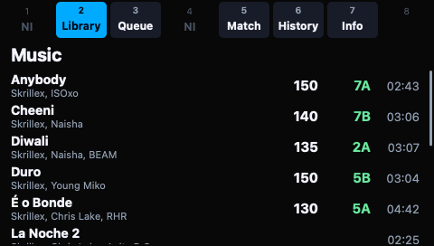 | 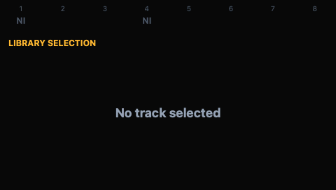 |
| `02-library-selected`: third track selected | 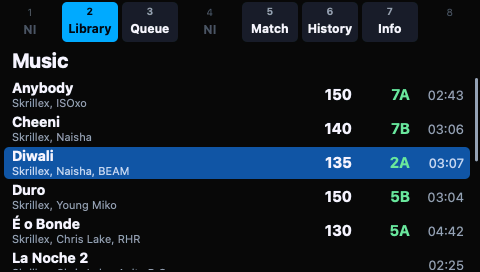 | 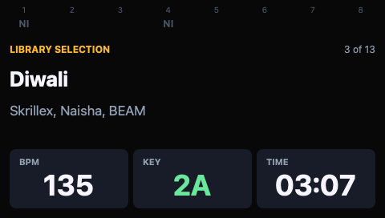 |
| `03-library-scrolled`: last track selected, list scrolled to keep it visible | 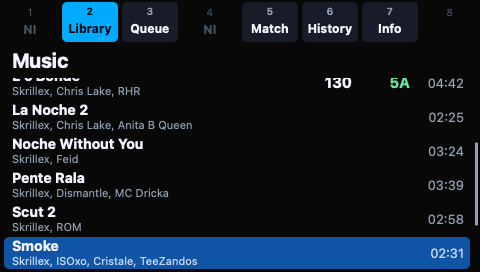 | 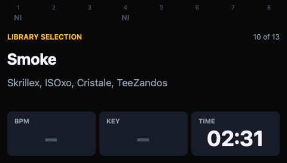 |
| `04-queue`: Queue tab, empty queue | 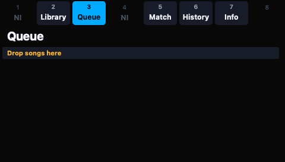 |  |
| `05-match`: Match tab; the right panel is unchanged, so no record is sent for it | 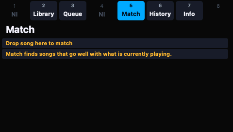 |  |
| `06-history`: History tab, session track selected | 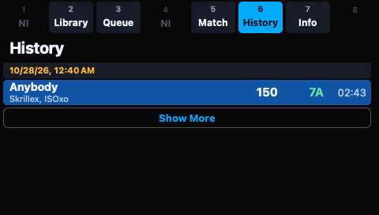 | 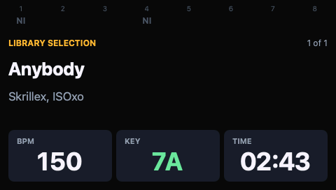 |
| `07-info`: Info tab; right buttons 2 and 3 are labelled Info and Related | 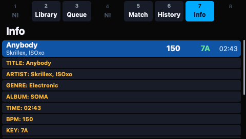 | 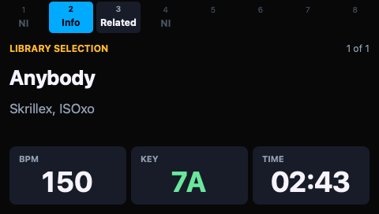 |
| `08-related`: Info > Related | 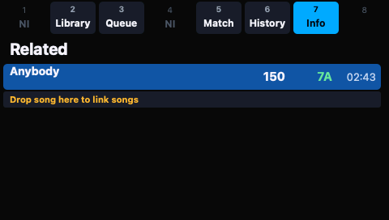 | 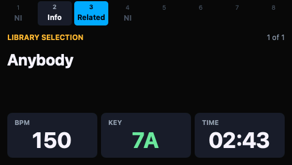 |
| `09-sidebar-closed`: djay's sidebar is hidden | 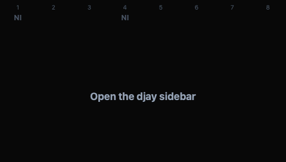 |  |
| `10-deck`: `--deck 1`, deck page on the right |  | 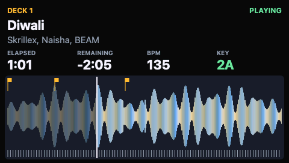 |

Layout, button slots and the frame format are described in
[`macos/S8Views/README.md`](../../macos/S8Views/README.md).

### Selection

The highlighted row is the row djay reports as selected in the sidebar table.
The right panel shows that track with "n of m", its position among the
tracks of the list. Without a selected track row it says "No track
selected". S8Host does not remember a selection itself: when djay drops it,
for example on a tab switch, the panels drop it too.

The list keeps its scroll position while the same tab and sub-tab stay open
and scrolls only as far as needed to keep the selected row visible. A tab
switch starts at the top.

## Updates

- A display button or screen encoder event is applied to djay first; the
  panels are drawn again from a fresh sidebar reading once no further event
  is waiting. A fast encoder turn therefore draws once, at its end.
- Changes made in djay itself (mouse, keyboard, a track ending) are picked
  up by the poll, by default within 1 s.
- With `--deck N` the deck is read every 0.25 s. The sidebar is not read
  again for a deck update.
- A panel is sent only when its picture differs from the last one sent for
  that panel. An idle djay sends nothing.
- The bridge paces transfers at 30 frames per second per panel and keeps
  only the newest unsent frame of each panel
  ([screen-transport.md](screen-transport.md#worker-behaviour)).

## Stop and panel state

Decision for #27: **a clean stop leaves both panels black.**

- On Ctrl-C, SIGTERM or when its own stdin closes, S8Host closes the
  bridge's stdin. The bridge sends black exit frames to each panel that
  received a frame, releases interface 6, prints `S8_SCREEN_STATUS inactive`
  and exits; S8Host exits with the bridge's status (0). If the bridge is
  still running 5 s after its stdin closed S8Host sends it SIGINT, and
  SIGTERM after 10 s.
- The panels stay black until something else draws on them. Relaunching
  NIHardwareAgent brings back the Controller Editor labels
  ([screen-transport-validation.md](screen-transport-validation.md)).
- S8Host does not relaunch the agent. A black panel says that nothing is
  driving the S8, where a kept last frame would look like a live view that
  no longer follows djay.
- A killed bridge (SIGKILL, crash) sends no exit frames. The example tool
  killed mid-stream left the S8's startup screens on both panels
  ([screen-stream-validation.md](screen-stream-validation.md)); this path is
  not checked through S8Host.

## Limits

- The sidebar is read up to 300 rows (`DjaySidebar.rowLimit`). Longer lists
  are cut there, on the panel and for "n of m".
- Only what djay's sidebar exposes through Accessibility is shown. With the
  sidebar hidden the left panel asks to open it.
- Reading the sidebar takes Accessibility calls for every row, so a poll
  under 1 s on a long list competes with the control events. Not measured.
- One deck page at a time, on the right panel. Decks 3 and 4 depend on how
  djay's four-deck layouts appear through Accessibility (#45).
- Buttons 1 and 4 stay with NI and do nothing while the agent is stopped.
- There is no LED feedback (#21).

## Expected pictures

`mise run s8:panel-views-images` regenerates the pictures;
`mise run s8:panel-views-images check` compares the committed ones with what
the tools produce now and fails when this page does not embed one. Both send
nothing and need neither djay nor the S8.

1. `S8Host --replay docs/s8/fixtures/panel-views --records DIR` runs each
   snapshot, in name order, through the same `LivePanels` and `PanelFeed`
   code as a live session and writes the records it would send to the
   bridge as `<name>.s8fr`. A file under `decks/` with the same name is the
   deck snapshot for that state.
2. `s8-screen-png --out DIR FILE...` reads the records with the bridge's
   stdin parser, builds the frame the bridge would transfer and decodes that
   frame's pixels into `<name>-left.png` and `<name>-right.png`. A panel
   without a record in a file keeps its previous picture.

## Attended check

Not run. It needs explicit approval because it stops NIHardwareAgent and
sends screen frames to the S8.

`mise run s8:panel-views` (`panel-views-check.sh`), at the S8 with djay Pro
and Controller Editor open, a track loaded on deck 1 and the sidebar on
Library with no sidebar row selected.

What is sent: full-panel literal frames (261,148 bytes) to interface 6, at
most 30 per second per panel, through the transport checked on the S8 in #44
([screen-transport-validation.md](screen-transport-validation.md)), and the
black exit frames. Nothing else is written: no LED reports, no feature
reports, no control transfers, nothing on interface 4.

The runner stops the agent with SIGKILL, runs S8Host twice, asks one
question per row and relaunches the agent on every exit path. Answering
`stop` to any row goes straight to recovery. Stop on any of these: a panel
that stays frozen or garbled, an S8 that goes dark, controls that stop
reaching djay.

| Row | Action | Expected |
| --- | --- | --- |
| 1 | Start (`--screens`) | Panels as `01-library` |
| 2 | Left encoder 1 until a track is selected, then two rows on | Highlight and right panel follow each row, as `02-library-selected` |
| 3 | Keep turning past the last visible row | List scrolls, highlight stays visible, as `03-library-scrolled` |
| 4 | Read "n of m" | Position of the row among the sidebar's tracks |
| 5 | Left button 3 | Queue, as `04-queue` or the current queue |
| 6 | Left button 5 | Match, as `05-match` |
| 7 | Left button 6 | History, as `06-history` with the current sessions |
| 8 | Left button 7 | Info, right buttons 2 and 3 labelled, as `07-info` |
| 9 | Right button 3, then right button 2 | Related as `08-related`, then Info |
| 10 | Left button 2 | Library |
| 11 | Select another sidebar row with the mouse | Panels follow within about 1 s |
| 12 | Hide djay's sidebar, then show it | "Open the djay sidebar" as `09-sidebar-closed`, then the list |
| 13 | Encoder turn to panel change | Reported: instant, short lag or seconds |
| 14 | Spin an encoder fast through a long list | Panels end on the row djay selected |
| 15 | Left PLAY | djay reacts while the screens run |
| 16 | Whole run | No flicker, tearing, wrong colours or frozen panel |
| 17 | Runner sends SIGINT to S8Host | Both panels black, exit status 0 |
| 18 | Start (`--screens --deck 1`) | Right: deck 1 page, layout as `10-deck`; left: library list |
| 19 | PLAY on deck 1, then again | PLAYING with moving time and playhead, then PAUSED |
| 20 | Left screen encoder | Left panel follows, deck page stays |
| 21 | Runner closes S8Host's stdin | Both panels black, exit status 0 |
| 22 | Agent relaunched | Controller Editor labels on the panels |
| 23 | Left PLAY | djay reacts through the Controller Editor setup |
| 24 | Display button 1 or 4 | NI action works again |

The record goes to `captures/panel-views-<UTC>/` (`notes.txt` with the
answers, `library.log` and `deck.log` with S8Host's and the bridge's output)
and the results into a validation record next to this page.

## Validation state

Covered by tests (`swift test --package-path macos --filter S8ViewsTests`):
the record layout, scroll kept per list and reset on a tab switch, the
selection following djay's selected row, and that only changed panels
produce records.

Checked without the S8: the replay and decode above, for the ten states.

Not checked, needs the S8 and djay together: everything in the attended
check, including the live sidebar reading under `--screens`, the update
delay and the panel state after a stop.
