# Phase 5: expected panel pictures

What each panel should show at every step of `mise run s8:screen-stream`
([plan](screens.md#phase-5-repeated-frames-held-claim-and-partial-updates)). Check a step
against its pictures first, then at the S8. The runner prints the files to compare with before
each prompt.

<?toc?>

- [Step a: held ladder, left panel then right panel](#step-a-held-ladder-left-panel-then-right-panel)
- [Step a, right panel](#step-a-right-panel)
- [Step b: alternating panels](#step-b-alternating-panels)
- [Step c: burst of 120 frames, left panel](#step-c-burst-of-120-frames-left-panel)
- [Step d: soak, 60 s alternating](#step-d-soak-60-s-alternating)
- [Step e: partial updates, left panel](#step-e-partial-updates-left-panel)
- [Step f: exit state](#step-f-exit-state)

<?/toc?>

Every picture is decoded from the bytes the tool would send. The header,
LITERAL, REPEAT, SKIP and footer are applied to a per-panel framebuffer at
480x272. So the pictures prove the frames and are not a second drawing of
the pattern. They are regenerated with `mise run s8:phase5-images` and
compared with `mise run s8:phase5-images check`; both send nothing.

How to read the test pattern: the title names the panel; the four colour blocks are fixed. The
row of 16 cells at the bottom is the frame number in binary, most significant bit on the left,
white = 1 (frame 49 is `0000000000110001`). The yellow bar under it moves right as the frame
number grows. File names are `step-rate-panel-fNNNN`, where NNNN counts from 0 within the step
per panel.

What pictures cannot show: motion smoothness, the achieved rate, timing, tearing, flicker and
stale areas. They show the content of single frames. Between samples only the counter and the
bar change.

Sampling: take the first and last frame of each rate stage of a ladder (a: 5
pictures per panel; b: 5 per panel, both panels). For a single stage (c, d)
take five frames spread from the first to the last.

## Step a: held ladder, left panel then right panel

Left panel at 10, 20, 30, 60 frames/s, 5 s each, then the right panel. First frame of the run
and the last frame of each stage. Command:
`stream --rates 10,20,30,60 --seconds 5 --panels left --screen left` (right: `right`).

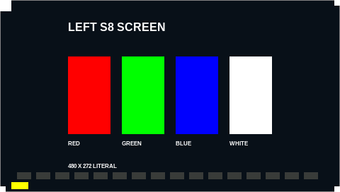

Left panel, 10fps stage, frame 0.

Left panel, 10fps stage, frame 49.

Left panel, 20fps stage, frame 99.

Left panel, 30fps stage, frame 149.

Left panel, 60fps stage, frame 299.

## Step a, right panel

Right panel, 10fps stage, frame 0.

Right panel, 10fps stage, frame 49.

Right panel, 20fps stage, frame 99.

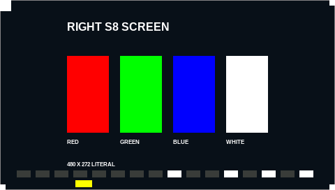

Right panel, 30fps stage, frame 149.

Right panel, 60fps stage, frame 299.

## Step b: alternating panels

Left, right, left, … at the same rates; the rate counts per panel. Both panels are drawn for
every sample; the panel never shows the other panel's title.

Left panel, 10fps stage, frame 0.

Left panel, 10fps stage, frame 49.

Right panel, 10fps stage, frame 0.

Right panel, 10fps stage, frame 49.

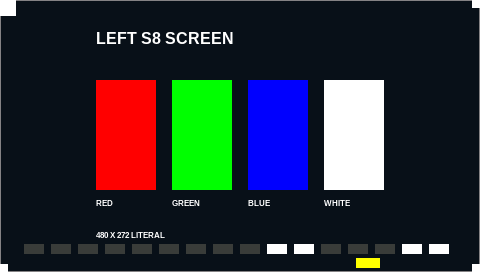

Left panel, 20fps stage, frame 99.

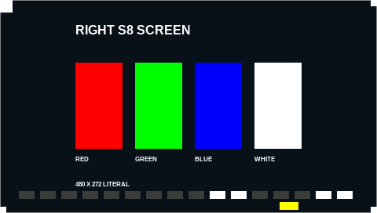

Right panel, 20fps stage, frame 99.

Left panel, 30fps stage, frame 149.

Right panel, 30fps stage, frame 149.

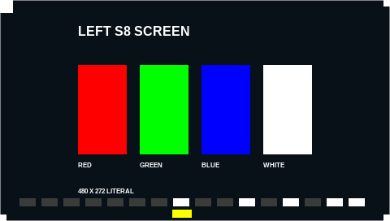

Left panel, 60fps stage, frame 299.

Right panel, 60fps stage, frame 299.

## Step c: burst of 120 frames, left panel

Back-to-back frames. The last picture (frame 119) is what stays on the panel afterwards.

Left panel, frame 0.

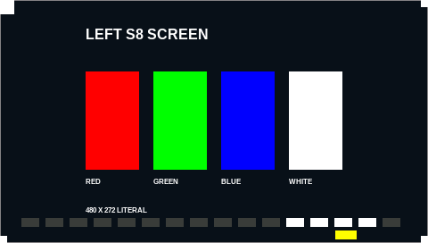

Left panel, frame 30.

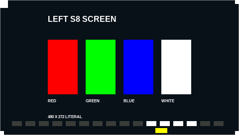

Left panel, frame 60.

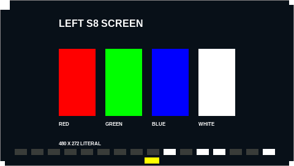

Left panel, frame 89.

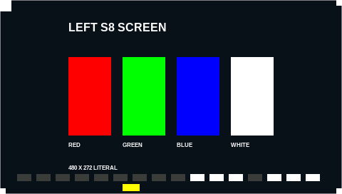

Left panel, frame 119, the final state.

## Step d: soak, 60 s alternating

Shown for 30 frames/s per panel. The runner uses the lower of the passed rates, capped at 30; a
lower rate changes only the frame numbers.

Left panel, frame 0.

Left panel, frame 450.

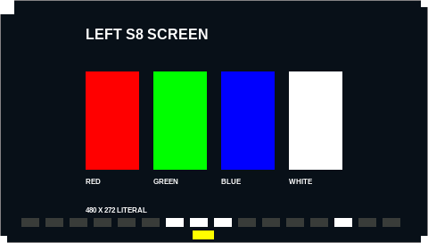

Left panel, frame 900.

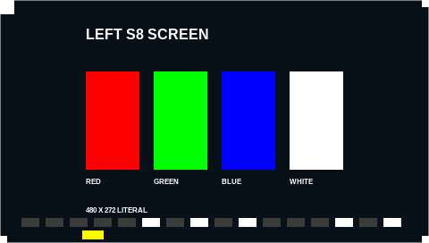

Left panel, frame 1349.

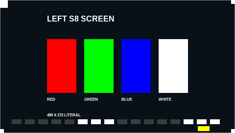

Left panel, frame 1799.

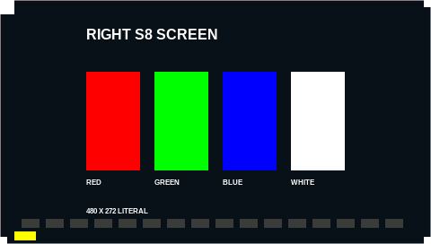

Right panel, frame 0.

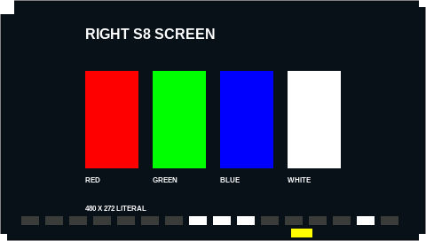

Right panel, frame 450.

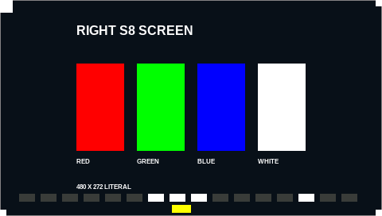

Right panel, frame 900.

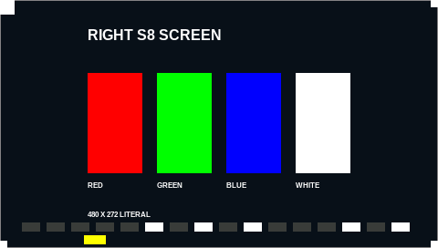

Right panel, frame 1349.

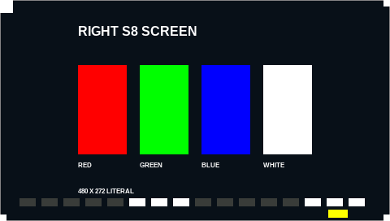

Right panel, frame 1799.

## Step e: partial updates, left panel

The F800 background, then each partial frame applied on top of it. The two partial pictures
show what appears **if the guessed SKIP and sub-rectangle formats are right**; the formats are
unverified hypotheses (see the plan).

e-bg-skip and e-bg-rect: solid F800 (red) background.

e-skip: top half stays background, bottom half shows eight colour bars, if SKIP works as
guessed.

e-rect: one 160x80 rectangle of colour bars in the middle, background around it, if the header
x,y bytes work as guessed.

## Step f: exit state

The tool stops sending without a final frame; the panels keep the last frame (#27).

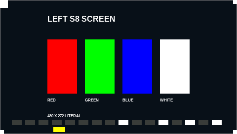

f-end, left panel: last frame of the stream, frame 149; stays on screen.

f-end, right panel: last frame of the stream, frame 149; stays on screen.

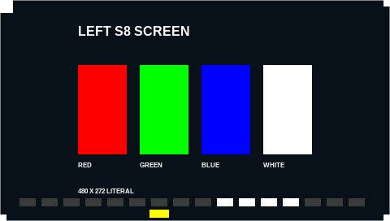

f-kill, left panel: frame 120, the frame nearest 4 s. Approximate: the kill can cut a transfer,
and the panel may show a frame a little earlier or later.

f-kill, right panel: frame 120, the frame nearest 4 s. Approximate, as above.

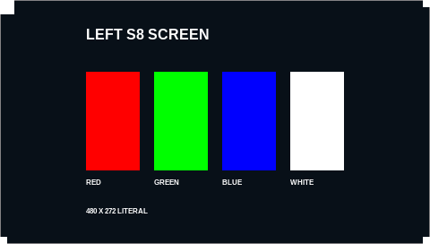

f-clean, left panel: the clean pattern after recovery.

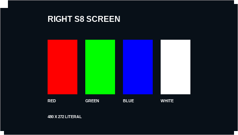

f-clean, right panel: the clean pattern after recovery.
