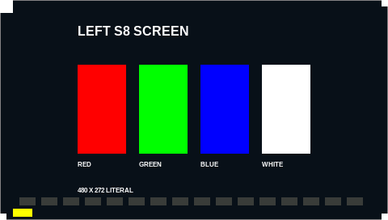
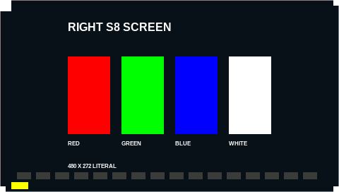
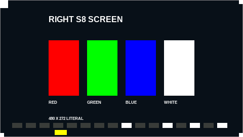
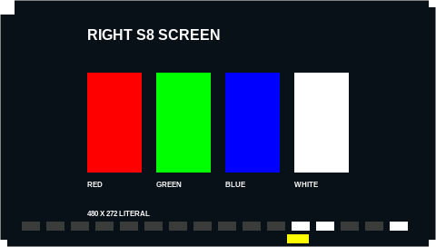
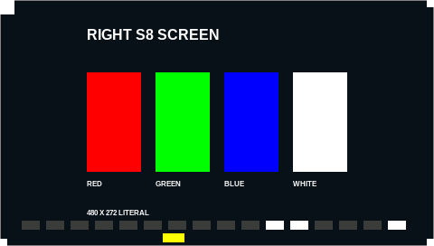
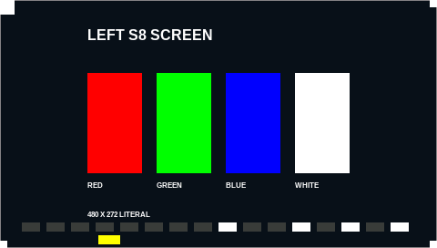
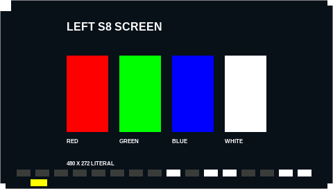
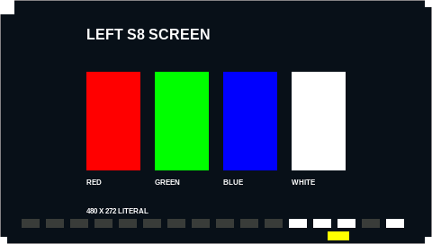
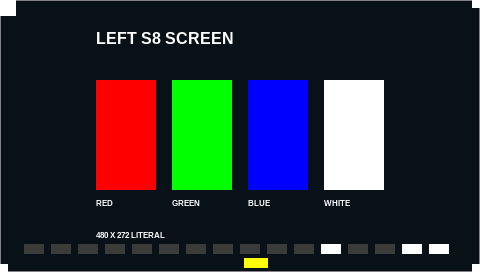

# S8 screen transport channel

How the macOS app and the bridge exchange S8 screen frames and control
events over the bridge's standard streams (#44, #51). The Swift side codes
against this file.

Status: the code and its fake-transport tests are written; **nothing here
has been run against a device**. The last section lists what only hardware
can confirm.

<?toc?>

- [Flags](#flags)
- [Control events](#control-events)
- [Frame records](#frame-records)
  - [What the bridge sends to the device](#what-the-bridge-sends-to-the-device)
  - [Stream rules](#stream-rules)
- [Status lines](#status-lines)
- [Worker behaviour](#worker-behaviour)
- [Validation state](#validation-state)
- [Attended check](#attended-check)
  - [Preconditions](#preconditions)
  - [What the pictures show](#what-the-pictures-show)
  - [Steps](#steps)
  - [Recovery and what to record](#recovery-and-what-to-record)

<?/toc?>

## Flags

Both flags are for the Kontrol S8 only and need `--midi full`. The S4 MK3
refuses them with a clear message, and the S8 still refuses the S4 screen
flags `--screens` and `--screen-control-stdin`.

| Flag                 | Direction            | Content              |
| -------------------- | -------------------- | -------------------- |
| `--app-events`       | bridge → app, stdout | `S8_CONTROL` lines   |
| `--s8-screens-stdin` | app → bridge, stdin  | `S8FR` frame records |

`--s8-screens-stdin` also writes `S8_SCREEN_STATUS` lines on stdout.
Every line starts at column 0 and ends with `\n`. Bridge log output may
share stdout; a reader MUST ignore lines with other prefixes.

## Control events

Flag `--app-events`, added by #51; this section is its specification.

```text
S8_CONTROL display_button <left|right> <2|3|5|6|7|8> <down|up>
S8_CONTROL screen_encoder <left|right> <1-4> <signed delta in counts>
```

- Encdr names `{left|right}_screen_left_{1-4}` are display buttons 1–4 and
  `{left|right}_screen_right_{1-4}` are buttons 5–8.
- Buttons 1 and 4 belong to Native Instruments (colour settings, Controller
  Editor template switch) and are never emitted.
- Encoder deltas are in counts, 1000 per turn, clockwise positive.
- The first report of each report ID after start records resting state only
  and emits nothing.

## Frame records

Flag `--s8-screens-stdin`. The app writes records to the bridge's stdin.
Records are back to back with no padding. A record is a 12-byte header
followed by the payload.

| Offset | Size   | Field                                                            |
| ------ | ------ | ---------------------------------------------------------------- |
| 0      | 4      | ASCII `S8FR` (`53 38 46 52`)                                     |
| 4      | 1      | panel: `0` left, `1` right                                       |
| 5      | 3      | zero                                                             |
| 8      | 4      | payload length, `u32` little-endian, `261120`                    |
| 12     | 261120 | 480 × 272 pixels, RGB565 big-endian, row-major from the top left |

Pixels are two bytes each (`PIXEL_BYTES` = 480 × 272 × 2 = 261 120). The
bridge adds the framing itself (header, the full-panel literal
command `00 00 FF 00`, footer); the app never sends those bytes. Each frame
is one complete panel image: the channel has no partial updates.

### What the bridge sends to the device

For each accepted record the bridge sends one USB bulk transfer. It is
`FRAME_BYTES` = 261 148 bytes to interface 6, endpoint `0x04`. It is built
by `screen::full`: frame header, command `00 00 FF 00`, the pixels, footer.
Full-panel literal frames are hardware-validated
([screen-frame-validation.md](screen-frame-validation.md)).

### Stream rules

- EOF between records is a clean stop. The bridge stops the same way it does
  on Ctrl-C or the time limit: exit frames, release, `inactive`, exit.
- The app MUST keep stdin open for as long as it wants the bridge to run.
  Closing stdin stops the whole bridge, MIDI included, as EOF does on the
  S4 `--screen-control-stdin` channel.
- Reads may arrive in any size; records may be split across writes.
- Any of these is a protocol error: wrong magic, panel other than 0 or 1,
  non-zero bytes 5–7, a length other than `261120`, EOF inside a record
  (header or payload), or a read error. The stream cannot be resynchronised.
  The bridge then reports `S8_SCREEN_STATUS failed <reason>`, stops the
  screen path (exit frames to the panels that got a frame, release) and
  keeps MIDI running. It reads and discards the rest of stdin so the writer
  never blocks, and EOF still stops the bridge.

## Status lines

```text
S8_SCREEN_STATUS pending
S8_SCREEN_STATUS active
S8_SCREEN_STATUS inactive
S8_SCREEN_STATUS failed <reason>
```

`<reason>` is one line (control characters are replaced by spaces).

| State      | Meaning                                                       |
| ---------- | ------------------------------------------------------------- |
| `pending`  | Flag set, nothing claimed. Printed once at start.             |
| `active`   | The device accepted the first frame. Printed once.            |
| `inactive` | Exit frames sent and the interface released cleanly.          |
| `failed`   | A claim or transfer failed, or a protocol error. Final state. |

Order: `pending`, then `active` once the first transfer succeeds, then
exactly one of `inactive` or `failed`. A failure before the first frame goes
`pending` → `failed`; a clean stop before any frame goes `pending` →
`inactive` (nothing was claimed, so nothing is sent). `failed` and
`inactive` are final: there is no retry and no re-arming in the same bridge
process, and frames arriving afterwards are discarded. To retry, restart the
bridge.

The reader of stdout MUST stay for as long as the bridge should run. When a
status line or an `S8_CONTROL` line cannot be written because the reader is
gone, the bridge stops as on Ctrl-C: exit frames, release, exit status 0.
Log lines to a closed stdout are dropped.

## Worker behaviour

Placement:

- `src/device/s8/screen/{wire,worker,usb}.rs` are in the library next to
  the frame encoder. The stdin parser and the worker are testable without
  the binary.
- `src/s8/screens.rs` in the binary holds the stdout status lines, the
  stdin thread and the flag check.

Behaviour:

- **Claim once.** Interface 6 is claimed when the first frame is due and
  held until stop. Nothing is claimed while the app sends nothing.
- **Latest wins.** Each panel has one slot. A newer record for a panel
  replaces an unsent older one. The reader thread only copies into the slot,
  so a slow transfer never blocks stdin reading, the HID loop or MIDI.
- **One panel does not resend the other.** A transfer happens only for a
  panel that has a new, unsent frame. An unchanged panel is never repeated.
- **Pacing.** The start of two transfers to the same panel are at least
  `FRAME_INTERVAL` apart: 30 frames per second per panel
  (`MAX_FRAMES_PER_SECOND`). Phase 5 measured about 16.6 ms per full frame,
  so 30 per panel is the most two panels can take together
  ([screen-stream-validation.md](screen-stream-validation.md)). Frames
  dropped by pacing are the older ones of the slot. When both panels are
  ready they alternate.
- **One transfer per frame**, 500 ms timeout, no retry. A failed or short
  transfer, or a failed claim, reports `failed <reason>` and releases the
  interface. A failed transfer sends no exit frames; the claim is released.
- **Exit frames.** On a clean stop and after a protocol error, the bridge
  sends `screen::solid` black (`00 00 00 00` pixel pairs) to each panel that
  received a frame, then releases the interface. #27 kept this: a clean stop
  leaves the panels black, so no stale view stays on the S8
  ([panel-views.md](panel-views.md#stop-and-panel-state)). The frames equal
  the black frames in the validation record.
- **NIHardwareAgent.** The bridge neither looks for nor stops
  NIHardwareAgent. If the agent holds interface 6 the claim fails and the
  bridge reports `failed <reason>` while MIDI keeps running. Stopping the
  agent is the caller's job, as for the rest of the full S8 bridge (#26,
  [agent-stop-validation.md](agent-stop-validation.md)).

## Validation state

Hardware-validated (from the bridge's example tools, not from this channel):

- Claiming interface 6 with the agent stopped.
- Full-panel literal and repeat frames on both panels, RGB565 big-endian,
  no init report needed.
- Holding interface 6 across 3,599 frames and releasing it afterwards.
- 30 frames per second per panel on both panels for 60 s, steady by eye,
  with the two panels updated back to back
  ([screen-stream-validation.md](screen-stream-validation.md)).

Covered by tests with a fake transport only:

- Record parsing, split reads, every protocol error, stream → worker →
  transport bytes for both panels, latest-wins under a blocked transfer,
  pacing, status order, claim and transfer failure, exit frames.

Checked on the S8 through this channel on 2026-11-10
([screen-transport-validation.md](screen-transport-validation.md)):

- Each panel alone and both panels back to back within one bridge process,
  at 10 and 30 frames per second per panel for 5 s.
- Frames dropped above the cap, with the last frame arriving.
- The last frame staying while stdin is open and idle.
- Black panels after the exit frames when stdin closes, and after a
  `failed` stop from a bad record.
- Ctrl-C of the bridge while it streams: exit frame, `inactive`, exit
  status 0. The first attempt aborted with status 134 and led to a fix
  ([record](screen-transport-validation.md#ctrl-c-while-streaming)).

Not validated on hardware (only a device can confirm):

- A stop because the reader of stdout is gone. Tests cover it; the passing
  Ctrl-C run kept its reader.
- What the panels show when the bridge is killed while it streams. The
  example tool killed mid-stream left the S8's startup screens on both
  panels.
- The claim failure when NIHardwareAgent holds interface 6, and that the
  reason text is useful.
- The 500 ms transfer timeout under a stalled device.
- stdin throughput: about 15.7 MB per second for two panels at the cap,
  for longer than 5 s.

## Attended check

Run on 2026-11-10; the results are in
[screen-transport-validation.md](screen-transport-validation.md). It drives
the real panels through the channel above with a feeder, one step at a time,
and checks the status lines, the pictures and the exit behaviour. The rest
of this section is the plan, not a result.

### Preconditions

- Phase 5 of #43 (`mise run s8:screen-stream`) has passed
  ([screen-stream-validation.md](screen-stream-validation.md)). This check
  does not replace it: it only exercises the bridge's worker and stdin path.
- Exactly one Kontrol S8 on USB; Traktor, Maschine and Komplete Kontrol
  quit; Djay open with no track playing.
- The user has approved sending frames to the S8. The runner prompts before
  every step and `stop` at any prompt ends the run.
- `NIHardwareAgent` is stopped by the runner (`kill -9`, as in the other
  attended runners) and relaunched with `open -g` on every exit path. The
  bridge itself never stops it (see above).
- Run it from an interactive terminal: `mise run s8:screen-transport`. To
  continue a run that stopped early, name the first step to run, for
  example `mise run s8:screen-transport c-alternate-10`. The
  runner builds the release bridge and `examples/s8-screen-feed`, writes
  `docs/s8/captures/screen-transport-<UTC>/` (per step: `.dry` record hashes,
  `.txt` bridge output, `.feeder.txt`; plus `notes.txt`, `snapshots.txt`,
  `events.txt`) and keeps nothing under `target/`. Commit the capture folder
  if the run matters.

Each step runs `s8-screen-feed … | bridge --device s8 --midi full
--s8-screens-stdin …`. Before the step the runner runs the feeder with
`--dry-run` (no device, no pacing; one `seq panel length sha256` line per
record) and prints the expected pictures. The runner fails a step when the
`S8_SCREEN_STATUS` order differs from the one stated, when the bridge exits
non-zero, or when the observer answers anything but `y`. The first failure
skips the rest and goes to recovery.

### What the pictures show

The feeder sends the stamped test pattern of phase 5 (`pattern::canvas` and
`pattern::stamp`). It has:

- a grey border
- white corner markers (large at the top left)
- the title `LEFT S8 SCREEN` or `RIGHT S8 SCREEN`
- colour bars red, green, blue and white
- the line `480 X 272 LITERAL`
- under it, a strip with a 16-bit binary counter (white = 1, dark grey =
  0, most significant bit left) and a yellow bar

Frame `n` of a panel (counting from 0 per panel) shows counter `n`, and the
bar's left edge at pixel `16 + (12·n mod 424)`.

The pictures are the content of the panel decoded from the frames the bridge
would send for the feeder's records: `S8FR` record → bridge frame bytes →
framebuffer. They are not a second rendering of the pattern. They show
content only: the real panels differ in brightness and colour, and a panel
that is not addressed keeps whatever it showed before the step. After a clean
stop both panels that received a frame show black:


### Steps

Rates are records per second per panel; `alternate` interleaves left and
right, so the stream carries twice that. "Hold" is how long the runner keeps
the bridge's stdin open after the last record. Every step ends with stdin
closing, so every step shows the exit frames last.

The bridge runs with `--until-stopped` in every step. A bounded run
(`--seconds`) exits with status 1 when no S8 control was touched during it.
These steps never ask for that, so the end of each step is stdin closing or
Ctrl-C.

1. **`a-left-10`: one panel, slow.** Left panel, 10 fps, 50 frames (5 s),
   hold 5 s. Status: `pending`, `active`, `inactive`. See: the left bar
   moving right in 12-pixel steps, the counter counting up to 49, the last
   frame staying for 5 s, then black. The right panel does not change.
   Pass: the observer sees all of that and the status order is exact.
   Fault: a frozen counter, a left frame on the right panel, a black or
   garbled panel, or `failed`: stop, note the status line and exit status,
   photograph, and go to recovery.

   
   
   

2. **`b-right-30`: other panel, at the cap.** Right panel, 30 fps, 150 frames
   (5 s), hold 5 s. See: a steady bar and counter up to 149, then black; the
   left panel does not change. Pass and fault as in step 1, plus any tearing,
   flicker or stale area that a single frame at a time would not have.

   
   

   At the cap a newer frame can replace one that has not been sent yet.
   The counter may therefore skip numbers on the real panel. Only the last
   frame is certain, hence no picture of a middle frame.

3. **`c-alternate-10`: both panels.** Alternating, 10 fps per panel, 50
   frames per panel (5 s, 100 records), hold 5 s. See: both panels counting
   up together, each with its own title, both ending at 49, then both black.
   Pass: each panel only ever shows its own title and a counter that never
   goes backwards. Fault: a panel that repeats or skips frames of the other,
   a swapped title, or a stall: stop and photograph.

   
   
   
   
   
   

4. **`d-alternate-30`: both panels at the cap.** Alternating, 30 fps per
   panel, 150 frames per panel (5 s, 300 records), hold 5 s. See: both
   counters up to 149 with a steady bar, then both black. Pass: steady, no
   tearing or flicker, and the status order exact. Fault: stutter, a panel
   that falls behind, or `failed`: stop. Phase 5 sent this load from the
   example tool without error, so a step 4 that fails while step 3 passed
   points at the bridge's worker or its stdin path.

   
   
   
   

   Phase 5 measured 16.6 ms per transfer, so two panels at 30 fps fill the
   USB time almost exactly. Skipped numbers are possible here; only the
   last frames are certain.

5. **`e-over-cap`: more than the cap.** Left panel, 60 fps, 180 frames (3
   s), hold 5 s. The feeder is twice as fast as the 30 fps pacing, so the
   bridge drops the older frame of the slot. See: the bar moving in visible
   jumps, and a counter that skips; the last frame is never dropped, so it
   ends at 179, holds, then black. Pass: final counter 179, no stall,
   status order exact. Fault: the counter ends below 179 (a lost last frame)
   or the display freezes while the feeder is still writing.

   

6. **`f-stall`: the feeder stops, stdin stays open.** Left panel, 10 fps, 30
   frames (3 s), then no records for 15 s with stdin open. See: the counter
   ends at 29 and the panel keeps frame 29 unchanged and without flicker
   for the whole 15 s, then goes black when stdin closes. The bridge does not
   blank the panel on its own and prints no new status line during the
   silence (`active` stays the last one). Pass: the panel holds, order is
   exact. Fault: the panel blanks, flickers or changes while the feeder is
   silent, or the bridge exits early.

   

7. **`g-eof`: the feeder closes stdin.** Alternating, 10 fps per panel, 30
   frames per panel (3 s), hold 0. See: both panels counting to 29, then
   both going black within about a second while the bridge exits by
   itself. Pass: both black, `pending`, `active`, `inactive`, exit status 0
   and the bridge gone within 15 s of starting (the runner measures it).
   Fault: a panel that keeps frame 29, a bridge that keeps running after EOF,
   or `failed`: stop.

   
   

8. **`h-bad-record`: protocol error.** Left panel, 10 fps, 20 frames, then 12
   bytes that are not a record (`NOPE` and eight zero bytes), then 5 s with
   stdin open. See: the counter ends at 19, then the panel goes black at once
   (exit frames). The bridge reports `failed bad record magic …` and keeps
   running (MIDI stays up) until the hold ends and stdin closes. Pass: status
   `pending`, `active`, `failed <reason>` and a black panel. Fault: the panel
   keeps frame 19, the bridge exits at the error, or later frames show.

   

9. **`i-ctrl-c`: Ctrl-C of the bridge.** Left panel, 10 fps, 600 frames
   (60 s), bridge with `--until-stopped`. The runner tells you when to
   start; press Ctrl-C once after 5 s or more, while the bar moves.

   See: the left panel goes black and the bridge exits. Pass: `pending`,
   `active`, `inactive`, and exit status 0. Ctrl-C ends the loop like EOF,
   after which the exit frames are sent; an `--until-stopped` run never
   fails on the control count.

   The frame at which Ctrl-C lands is not fixed, so the only picture is the
   start. Fault: a panel that keeps its last frame, a bridge that needs a
   second Ctrl-C, a non-zero exit status, or `failed`.

   

### Recovery and what to record

After the last step, or after the first failure or `stop`, the runner waits
3 s. It asks what the panels show with the agent still stopped (photo). It
then relaunches NIHardwareAgent with `open -g` and waits 5 s. It asks
whether the Controller Editor labels are back, then for a left PLAY press
and whether Djay reacted.

If the labels do not return, relaunch Controller Editor and the agent by
hand as in `docs/s8/agent-stop-validation.md`. The runner does the relaunch
on every exit path, including Ctrl-C of the runner itself and `kill`.

Record per step:

- the status lines, the bridge exit status and elapsed time (all in the
  capture folder)
- photos of the panels during and after
- anything the observer saw (tearing, flicker, stale areas, a frozen
  counter)

Write the results to `docs/s8/screen-transport-validation.md` after the
run, not into this plan. A passing run confirms the items under "Not
validated on hardware" for the first time on hardware. Two items stay
unconfirmed: the claim failure with the agent running and the 500 ms
timeout. Neither is exercised, because the agent is stopped and the device
never stalls.
